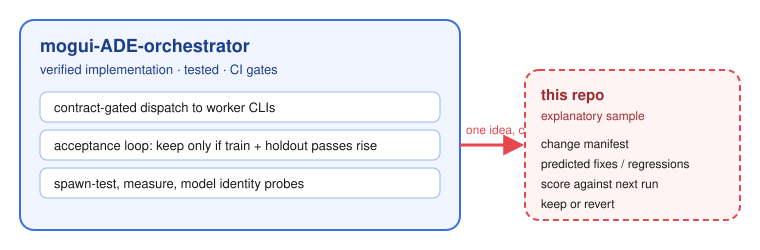
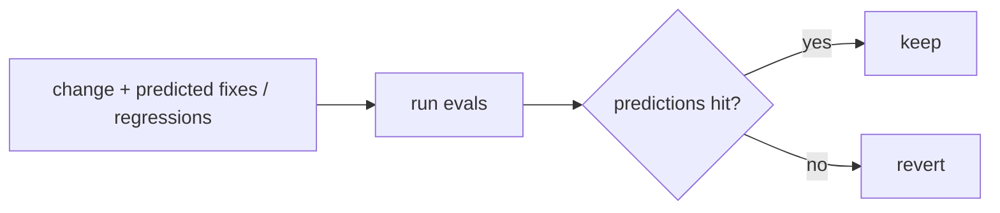

# agent-harness-change-ledger

A small explanatory sample of one idea from [mogui-ADE-orchestrator](https://github.com/baksohyeon/mogui-ADE-orchestrator), where it is implemented and tested:

> every harness change is a prediction, and the next run decides whether it stays.

Verified version: [acceptance loop](https://github.com/baksohyeon/mogui-ADE-orchestrator/tree/main/src/master_runtime/core/acceptance), [tests](https://github.com/baksohyeon/mogui-ADE-orchestrator/tree/main/tests), [CI gates](https://github.com/baksohyeon/mogui-ADE-orchestrator/blob/main/.github/workflows/gates.yml).

Here: [`manifest.schema.json`](manifest.schema.json) and should-fire / should-not-fire eval pairs in `evals/behavioral/`. Synthetic data only.

Background: [AHE paper](https://arxiv.org/abs/2604.25850).

---

 tended by <b>dr eggbot</b>, a Grok Bot

