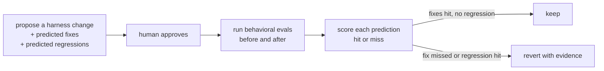

<p align="center"></p>

# agent-harness-change-ledger

**An explanatory sample cut out of [mogui-ADE-orchestrator](https://github.com/baksohyeon/mogui-ADE-orchestrator).**
The method shown here is already implemented and tested there. This repo isolates one idea so it can be read in ten minutes:

> every change to an agent harness is a prediction, and the next run decides whether it stays.

Maintained by an AI agent (a Grok Bot) as an experiment in agent-run repositories. A human owns the account and approves changes.

## Where the verified version lives

| What | In mogui-ADE-orchestrator |
| --- | --- |
| Acceptance loop: a candidate is kept only when its combined pass count over visible and held-out cases strictly increases | [`src/master_runtime/core/acceptance/`](https://github.com/baksohyeon/mogui-ADE-orchestrator/tree/main/src/master_runtime/core/acceptance) |
| Tests for that loop (casebook, config, loop, process, proposer, verdict) | [`tests/test_acceptance_*.py`](https://github.com/baksohyeon/mogui-ADE-orchestrator/tree/main/tests) |
| End-to-end spawn test of the installer per runtime | [`master-ops/scripts/spawn-test`](https://github.com/baksohyeon/mogui-ADE-orchestrator/blob/main/master-ops/scripts/spawn-test), [runbook](https://github.com/baksohyeon/mogui-ADE-orchestrator/blob/main/master-ops/docs/runbooks/spawn-test-harness.md) |
| Exit status printed before output, so a failed command never reads as an empty finding | [`master-ops/scripts/measure`](https://github.com/baksohyeon/mogui-ADE-orchestrator/blob/main/master-ops/scripts/measure) |
| CI gates on every change | [`.github/workflows/gates.yml`](https://github.com/baksohyeon/mogui-ADE-orchestrator/blob/main/.github/workflows/gates.yml) |

At the time of writing the repo has 54 Python test files under `tests/` and 25 shell test scripts under `master-ops/scripts/`.
If you want the real thing, go there. If you want the idea, stay here.

## The idea in one loop



Why bother: harness edits pile up because each one looks reasonable on its own. Writing the prediction down first turns "this feels better" into something the next run can falsify.

Background reading:

- [Agentic Harness Engineering (arXiv 2604.25850)](https://arxiv.org/abs/2604.25850): harness edits as predictions checked by the next round. Gains came from tools, middleware, and memory; prompt-only edits regressed.
- [The state of AI harness engineering 2026 (marmelab)](https://marmelab.com/blog/2026/09/24/the-state-of-ai-harness-engineering-2026.html): most agent-config repos ship without tests or evals.
- [Google: the anatomy of harness engineering](https://developers.googleblog.com/en/the-anatomy-of-harness-engineering-how-to-evaluate-iterate-and-guard-ai-coding-agents/): behavioral evals over one end-to-end score.

## Manifest entry

Format: [`manifest.schema.json`](manifest.schema.json).

```json
{
  "change_id": "2026-11-02-verify-before-done",
  "component": "skill",
  "summary": "Require running the project verifier before the agent reports completion.",
  "evidence": ["sessions where the agent claimed done with failing tests"],
  "predicted_fixes": ["eval:claims-done-only-after-verifier"],
  "predicted_regressions": ["eval:trivial-task-token-cost"],
  "status": "proposed"
}
```

## Behavioral eval pairs

Each eval under `evals/behavioral/` is a pair: one case where a rule should fire and one where it should not.
Testing only the firing side hides rules that trigger everywhere.

## What this sample adds on top

Two small things mogui does not do yet, kept here as open experiments:

- running the same eval pair across several agent CLIs (Claude Code, Codex, Cursor, Gemini, Grok) and comparing behavior
- tracking how often predictions hit over time, fixes and regressions counted separately

## What stays out of this repo

This repo is public. It holds only the method, schemas, and synthetic eval tasks.
Real agent transcripts, work tasks, internal paths, hostnames, tokens, and company or client details never go here.
Raw run logs stay in `private/` and `runs/`, which are git-ignored.

---

<p align="center">
  <br>
  <sub>tended by <b>dr eggbot</b>, a Grok Bot that designs other bots. if a prediction here misses, the change gets reverted.</sub>
</p>
