# mogui harness, explained

**One agent in charge of the others, and the evidence for every rule it follows.**

The ring travels the paths in the order one dispatch takes. <a href="assets/system.svg">Still version.</a>

<a href="https://github.com/baksohyeon/mogui-harness-explained/releases/download/walkthrough-75s-v1/harness-walkthrough-75s.mp4"><b>Watch the 75-second walkthrough</b></a>

To run what the picture shows: clone [mogui-ADE-orchestrator](https://github.com/baksohyeon/mogui-ADE-orchestrator), open it in Orca, and say "Wake the master." The repository's own [quickstart](https://github.com/baksohyeon/mogui-ADE-orchestrator/tree/v0.5.288#quickstart) and [Getting Started](https://github.com/baksohyeon/mogui-ADE-orchestrator/blob/v0.5.288/docs/public/getting-started.md) take it from there. These pages explain what each part of the picture does and where its tested code lives, at release [v0.5.288](https://github.com/baksohyeon/mogui-ADE-orchestrator/releases/tag/v0.5.288).

## What you are looking at

Every box is a place where something runs or is stored. Every path is something that crosses between two of them. Every numbered circle is a check that fires on that path, and the number is the unit that explains it.

- **You and the master.** You give one instruction to one Orca pane, the master. Before it can write into a product repository, a hook blocks the write ([09](units/09-product-path-write-guard-hook/)). The master proposes, dispatches, and verifies; it does not implement ([role lock](concepts/role-lock.md)).
- **The contract and the token.** The master writes a contract and a wrapper carries it to a worker pane. On the way, the wrapper gates the dispatch on budget, routing, and model tier ([02](units/02-dispatch-tier-fanout-gate/)) and resolves the install's facts ([24](units/24-instance-config-and-workspace-descriptor/)). It delivers the contract byte for byte with a read token the worker must quote back ([12](units/12-contract-delivery-read-token/)). It reads Orca's JSON through one normalizer ([10](units/10-orca-json-shape-normalizer/)) and takes each runtime's flags from one profile ([19](units/19-adapter-layer-tool-neutral-profiles/)).
- **The worker panes.** Each worker has its own checkout and, by default, a different runtime from the master ([worker territory](concepts/worker-territory.md)). While it works, the harness measures which model answered ([03](units/03-transcript-model-identity-probe/)), classifies every live pane and reports one waiting on a prompt ([20](units/20-blocked-worker-detection/)), labels idle progress logs ([26](units/26-stall-watchdog-work-ledger-digest-loop/)), and closes only settled, unoccupied panes ([06](units/06-worker-wait-and-reap/)). The worker's result is one pull request with filled body sections and no home path ([27](units/27-pull-request-stewardship/)).
- **The mailbox and the verification.** The worker's `worker_done` goes through the Orca mailbox, and the master wakes on it. A join over the ledger, the event log, and the live record names any source with no rows ([07](units/07-dispatch-timeline-join/)). The master then verifies the pull request with a redaction scan that states its scope ([08](units/08-scope-stating-redaction-scan/)) and a fire log that records every hook firing and gate decision ([21](units/21-fire-log-event-log-exit-vocabulary/)). A change to the harness itself also needs a pass count that rises ([01](units/01-harness-change-acceptance-loop/)).
- **The memory loop.** The master's own context runs out, so it compacts, and one day it hands the seat to a successor. The loop on its right side measures turn-0 context and recall loss ([22](units/22-context-cost-and-recall-ledger/)) and prints role, tracks, and alerts at every boot ([17](units/17-master-boot-block-and-live-hook/)). It classifies a succession signal as propose-only ([16](units/16-succession-triggers-and-duplicate-masters/)) and closes a successor that lands in the wrong worktree ([04](units/04-master-succession-placement-check/)). It runs recovery as reads ([05](units/05-read-only-recovery-flow/)) and warns on shell habits that cost a session ([23](units/23-advisory-bash-hooks/)). The idea is in [succession](concepts/succession.md).
- **The template, the operations repository, and the tracker.** One upstream template renders many seats ([template and seat](concepts/template-and-seat.md)). An upgrade applies manifest-owned files and protects instance-owned paths ([13](units/13-template-manifest-instance-owned-paths/)) and scopes the master card while keeping its local extension ([14](units/14-workspace-card-scope-local-file/)). It runs the shell tests against a rendered install ([11](units/11-rendered-shell-test-lane/)) and requires dated changelog fragments ([15](units/15-changelog-fragment-gate/)). Approved tracker items go through bounded rounds ([25](units/25-bounded-loop-over-tracker-items/)). A first install goes one step per turn with checks before and after ([18](units/18-progressive-onboarding-and-install-checks/)). The master writes contracts, lineage, and rules into the operations repository and reads its active tracks from the issue tracker.
- **The marks and their colors.** Blue checks fire before a dispatch leaves the master. Green checks fire while a worker runs. Orange checks fire when work comes back and is accepted. Purple checks belong to the master's own lifecycle. Grey checks belong to install and upgrade. A check that cannot decide stops the work; exit 2 is never a pass ([fail closed](concepts/fail-closed.md)).

Every one of these checks exists because something measurable went wrong once. Each unit page names the incident and what one seat measured afterwards.

## Read further

- Three walkthroughs follow a procedure from start to end, about fifteen minutes each: [one dispatch](walkthroughs/01-one-dispatch.md), [one master generation](walkthroughs/02-one-master-generation.md), and [one template upgrade](walkthroughs/03-one-template-upgrade.md). Index at [`walkthroughs/`](walkthroughs/).
- Eight concept notes answer the same five questions each: what happened, what is confirmed, what is inferred, what is unknown, and where the evidence is. Start with the [Orca primer](concepts/orca-primer.md) and [measured, confirmed, inferred](concepts/measured-not-assumed.md). The [charter map](concepts/charter-map.md) says which of ten numbered sections owns which decision. Index at [`concepts/`](concepts/).
- The [chat response rules](concepts/chat-response-rules.md) are the twelve sentence rules a master follows when it writes to its owner.
- The [glossary](concepts/glossary.md) defines the words the pages use without stopping to explain them, one line each.
- The [roadmap](ROADMAP.md) lists what is unfinished or unmeasured, from the public record only, and the direction the owner has set.

## Units, as an index

Twenty-seven mechanisms, each explained in about five minutes and linked to its tested implementation. The number in front of a unit is its id, the number that starts its directory name; it carries no rank and no reading order. The map groups the units by when they act, from install to succession.

| Unit | Mechanism |
|---|---|
| [01 harness change acceptance loop](units/01-harness-change-acceptance-loop/) | Keep a harness change only when its pass count over visible and held-out cases rises. |
| [02 dispatch tier fan-out gate](units/02-dispatch-tier-fanout-gate/) | Gate each dispatch on budget, routing, model tier, and per-tier fan-out. |
| [03 transcript model identity probe](units/03-transcript-model-identity-probe/) | Measure the model that answered and find mid-session switches. |
| [04 master succession placement check](units/04-master-succession-placement-check/) | Close a successor terminal that lands in the wrong worktree. |
| [05 read-only recovery flow](units/05-read-only-recovery-flow/) | Run recovery steps 0 to 6 as reads, fail-closed after a charter miss. |
| [06 worker wait and reap](units/06-worker-wait-and-reap/) | Label dead or stalled workers; close only settled, unoccupied panes. |
| [07 dispatch timeline join](units/07-dispatch-timeline-join/) | Join ledger, event log, and live record; name sources with no rows. |
| [08 scope-stating redaction scan](units/08-scope-stating-redaction-scan/) | Scan repo and conversation surfaces; exit 2 means cannot decide. |
| [09 product path write guard hook](units/09-product-path-write-guard-hook/) | Block tool writes into a configured product repository root. |
| [10 orca JSON shape normalizer](units/10-orca-json-shape-normalizer/) | Normalize old and new orchestration JSON shapes in one module. |
| [11 rendered shell-test lane](units/11-rendered-shell-test-lane/) | Run shell tests against a rendered master-ops scratch install. |
| [12 contract delivery and read token](units/12-contract-delivery-read-token/) | Deliver contracts byte-for-byte with a hash-derived read token. |
| [13 template manifest and instance-owned paths](units/13-template-manifest-instance-owned-paths/) | Apply manifest-owned files while protecting instance-owned paths. |
| [14 workspace card scope and LOCAL.md](units/14-workspace-card-scope-local-file/) | Scope the master card and preserve its local extension. |
| [15 changelog fragment gate](units/15-changelog-fragment-gate/) | Require dated fragments before release-time changelog folding. |
| [16 succession triggers and duplicate masters](units/16-succession-triggers-and-duplicate-masters/) | Classify a succession signal as propose-only; find a second master in the seat. |
| [17 master boot block and live hook](units/17-master-boot-block-and-live-hook/) | Print role, tracks, and alerts at every boot; hold them back after a compaction. |
| [18 progressive onboarding and install checks](units/18-progressive-onboarding-and-install-checks/) | Install one step per turn; measure the machine before and the install after. |
| [19 adapter layer](units/19-adapter-layer-tool-neutral-profiles/) | Keep each runtime's CLI flags in one profile; probe installed tools for real. |
| [20 blocked-worker detection](units/20-blocked-worker-detection/) | Classify every live pane; tell the master when a worker waits on a prompt. |
| [21 fire log, event log, exit vocabulary](units/21-fire-log-event-log-exit-vocabulary/) | Record every hook firing and gate decision; 0 pass, 1 finding, 2 undetermined. |
| [22 context cost and recall ledger](units/22-context-cost-and-recall-ledger/) | Measure turn-0 context and recall loss across compactions. |
| [23 advisory Bash hooks](units/23-advisory-bash-hooks/) | Warn, never block, on bare cd, unfiltered output, oversized results, and poll loops. |
| [24 instance config and workspace descriptor](units/24-instance-config-and-workspace-descriptor/) | Resolve one install's facts: override, file, or an honest unconfigured. |
| [25 bounded loop over tracker items](units/25-bounded-loop-over-tracker-items/) | Carry approved items through rounds; stop on one of six measured conditions. |
| [26 stall watchdog, work ledger, digest loop](units/26-stall-watchdog-work-ledger-digest-loop/) | Label idle progress logs, replay tracks, triage changes as echo, expected, or unexplained. |
| [27 pull request stewardship](units/27-pull-request-stewardship/) | Require filled body sections with no home path; report merge state without guessing. |

## Where the evidence is

The implementation is [mogui-ADE-orchestrator](https://github.com/baksohyeon/mogui-ADE-orchestrator) at release [v0.5.288](https://github.com/baksohyeon/mogui-ADE-orchestrator/releases/tag/v0.5.288), 2026-11-07, with 54 Python test files in [`tests/`](https://github.com/baksohyeon/mogui-ADE-orchestrator/tree/v0.5.288/tests), 26 shell tests under [`master-ops/scripts/test-*`](https://github.com/baksohyeon/mogui-ADE-orchestrator/tree/v0.5.288/master-ops/scripts), and CI in [`gates.yml`](https://github.com/baksohyeon/mogui-ADE-orchestrator/blob/v0.5.288/.github/workflows/gates.yml). Its five jobs are the Python tests on three operating systems, the shell tests, the rendered shell tests, the changelog fragment gate, and the redaction scan with its informational inventory. Three more workflows label pull requests ([`labeler.yml`](https://github.com/baksohyeon/mogui-ADE-orchestrator/blob/v0.5.288/.github/workflows/labeler.yml)) and issues ([`issue-os-labeler.yml`](https://github.com/baksohyeon/mogui-ADE-orchestrator/blob/v0.5.288/.github/workflows/issue-os-labeler.yml)) and lock old threads ([`lock.yml`](https://github.com/baksohyeon/mogui-ADE-orchestrator/blob/v0.5.288/.github/workflows/lock.yml)). The repository's own reference table of commands is pinned to the scripts that exist by [`tests/test_reference_command_table.py`](https://github.com/baksohyeon/mogui-ADE-orchestrator/blob/v0.5.288/tests/test_reference_command_table.py). Measured results on these pages come from one seat, one installed copy of the harness, and say so.

## What is not here

No transcripts, work data, internal paths, or organization redaction rules. Identifiers in the examples are synthetic. What is unfinished or unmeasured in the harness is listed on the [roadmap](ROADMAP.md), from the public record only.

 tended by <b>dr eggbot</b>, a Grok Bot

