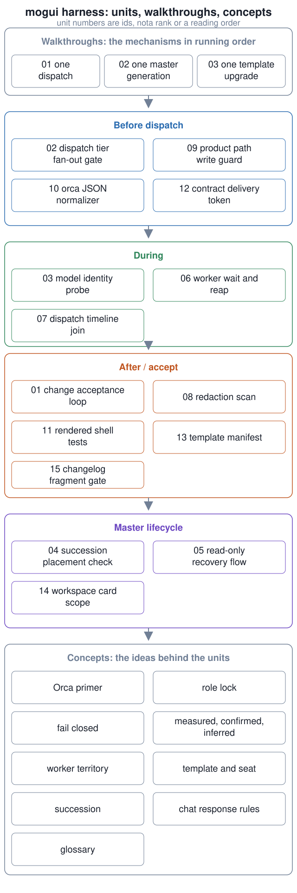

# mogui harness, explained

This repo splits the mogui-ADE-orchestrator harness into 9 small units, each explaining one mechanism in about 5 minutes and linking to its tested implementation.

| Unit | Mechanism |
|---|---|
| [01 harness change acceptance loop](units/01-harness-change-acceptance-loop/) | Keep a change only when combined visible+holdout passes strictly rise. |
| [02 dispatch tier fan-out gate](units/02-dispatch-tier-fanout-gate/) | Gate each dispatch on budget, routing, model tier, and per-tier fan-out. |
| [03 transcript model identity probe](units/03-transcript-model-identity-probe/) | Measure the model that actually answered and find mid-session switches. |
| [04 master succession placement check](units/04-master-succession-placement-check/) | Close a successor terminal that lands in the wrong worktree. |
| [05 read-only recovery flow](units/05-read-only-recovery-flow/) | Run recovery steps 0 to 6 as reads, fail-closed after a charter miss. |
| [06 worker wait and reap](units/06-worker-wait-and-reap/) | Label dead or stalled workers; close only settled, unoccupied panes. |
| [07 dispatch timeline join](units/07-dispatch-timeline-join/) | Join ledger, event log, and live record; name sources with no rows. |
| [08 scope-stating redaction scan](units/08-scope-stating-redaction-scan/) | Scan repo and conversation surfaces; exit 2 means cannot decide. |
| [09 product path write guard hook](units/09-product-path-write-guard-hook/) | Block tool writes into a configured product repository root. |

**Verified implementation:** [mogui-ADE-orchestrator](https://github.com/baksohyeon/mogui-ADE-orchestrator), with 54 Python test files in [`tests/`](https://github.com/baksohyeon/mogui-ADE-orchestrator/tree/main/tests), 25 shell tests under [`master-ops/scripts/test-*`](https://github.com/baksohyeon/mogui-ADE-orchestrator/tree/main/master-ops/scripts), and CI in [`gates.yml`](https://github.com/baksohyeon/mogui-ADE-orchestrator/blob/main/.github/workflows/gates.yml).

**What is not here:** no transcripts, work data, internal paths, or organization redaction rules. Examples are synthetic.

 tended by <b>dr eggbot</b>, a Grok Bot

