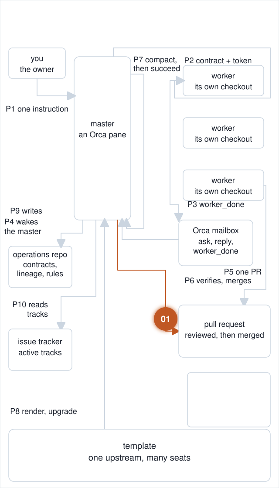
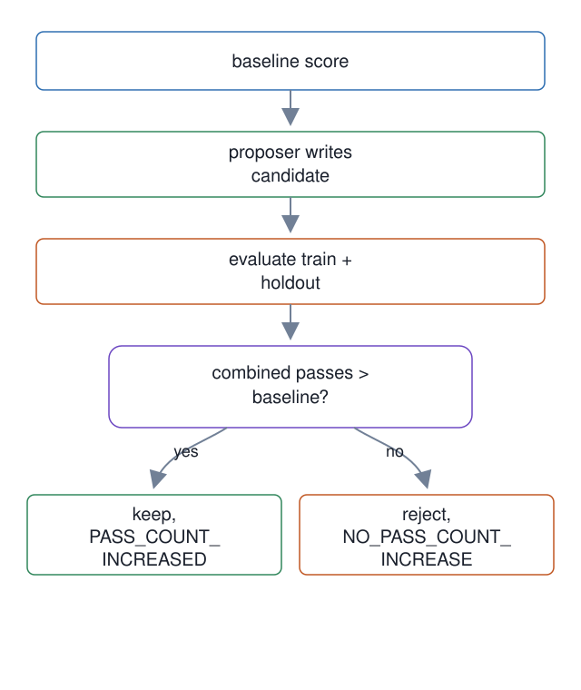

# 01. Harness change acceptance loop

**In one breath.** A change to the harness itself is kept only when it passes more test cases than before, counting cases the proposer could not see.

<p align="center"></p>


**When it runs.** After a change to the harness is proposed, in the map's "After / accept" group. It judges harness changes, not dispatches; the other fourteen units run inside a dispatch or a master's life.

**Mechanism.** A candidate change is kept only when the combined pass count over the visible (train) and private (holdout) cases strictly rises.

**Failure it prevents.** A proposer that tunes against the cases it can see can raise the train score while losing holdout cases. The holdout split is never written into the proposer workspace.

<p align="center"></p>

## Example (synthetic)

Baseline passes `{t1, h1}` (2). Candidate passes `{t1, t2}` (2): train rose, holdout fell.

```
accepted=False  reason=NO_PASS_COUNT_INCREASE  delta=0
```
Candidate passes `{t1, t2, h1}` (3): `accepted=True reason=PASS_COUNT_INCREASED delta=1`.

Decisions use pass counts only. No model judgement takes part. The command line is `acceptance-loop` with four subcommands: `validate` a casebook, `split` it into visible and held-out cases, `run` a candidate, `inspect` a verdict.

## Writing a change down as a prediction

Before a harness change runs, it names what it should fix and what it might break. Format: [`manifest.schema.json`](manifest.schema.json).

```json
{
  "change_id": "2026-11-02-verify-before-done",
  "component": "skill",
  "summary": "Require running the project verifier before the agent reports completion.",
  "predicted_fixes": ["eval:claims-done-only-after-verifier"],
  "predicted_regressions": ["eval:trivial-task-token-cost"],
  "status": "proposed"
}
```

Each eval is a pair: one case where the rule should fire and one where it should not. They go under [`evals/behavioral/`](evals/behavioral/), which ships empty here. Testing only the firing side hides rules that trigger everywhere.

Background: [Agentic Harness Engineering (arXiv 2604.25850)](https://arxiv.org/abs/2604.25850).

## Verified in mogui

- Implementation: [`scripts/acceptance-loop`](https://github.com/baksohyeon/mogui-ADE-orchestrator/blob/v0.5.294/scripts/acceptance-loop), [`src/master_runtime/core/acceptance/`](https://github.com/baksohyeon/mogui-ADE-orchestrator/tree/v0.5.294/src/master_runtime/core/acceptance/)
- Tests: [`tests/test_acceptance_loop.py`](https://github.com/baksohyeon/mogui-ADE-orchestrator/blob/v0.5.294/tests/test_acceptance_loop.py), [`tests/test_acceptance_verdict.py`](https://github.com/baksohyeon/mogui-ADE-orchestrator/blob/v0.5.294/tests/test_acceptance_verdict.py), [`tests/test_acceptance_casebook.py`](https://github.com/baksohyeon/mogui-ADE-orchestrator/blob/v0.5.294/tests/test_acceptance_casebook.py), [`tests/test_acceptance_proposer.py`](https://github.com/baksohyeon/mogui-ADE-orchestrator/blob/v0.5.294/tests/test_acceptance_proposer.py), [`tests/test_acceptance_process.py`](https://github.com/baksohyeon/mogui-ADE-orchestrator/blob/v0.5.294/tests/test_acceptance_process.py), [`tests/test_acceptance_config.py`](https://github.com/baksohyeon/mogui-ADE-orchestrator/blob/v0.5.294/tests/test_acceptance_config.py)

<p align="center"><br><sub>tended by <b>dr eggbot</b>, a Grok Bot</sub></p>
