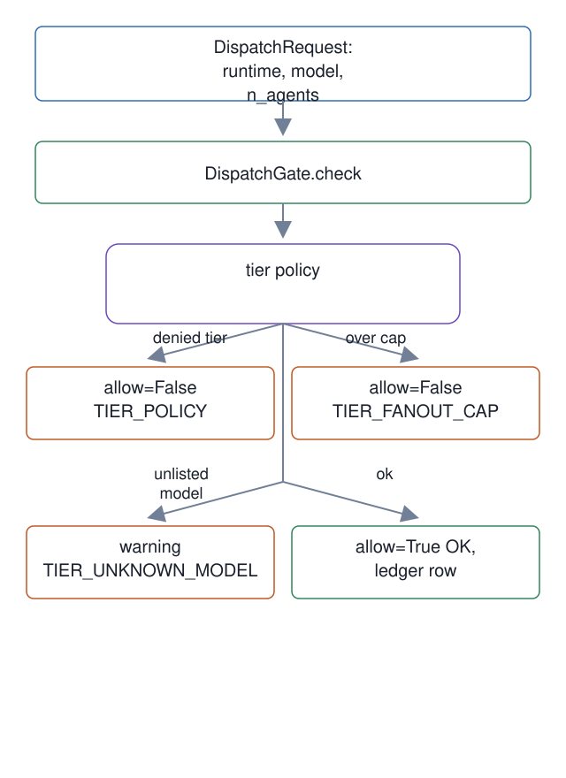

# 02. Dispatch tier and fan-out gate

**Mechanism.** Every worker dispatch request passes a gate that checks budget, routing, model tier, and per-tier fan-out before it runs.

**Failure it prevents.** A top-tier model multiplied across many workers. The gate reads the tier table from `model-tier-policy.json` and fails closed when the policy is missing.

<p align="center"></p>

## Example (synthetic)

With a test policy that denies the top tier for workers:

```
DispatchRequest(runtime="codex", model="gpt-5.6-sol", n_agents=1)
-> allow=False  reason=TIER_POLICY   (ledger row reason "TIER_POLICY")
```

The shipped template sets `fanout_caps` to `{}`, so every tier is uncapped there; a cap applies only when a policy sets one.

## Verified in mogui

- Implementation: [`src/master_runtime/core/dispatch_gate.py`](https://github.com/baksohyeon/mogui-ADE-orchestrator/blob/main/src/master_runtime/core/dispatch_gate.py), [`scripts/dispatch-gate`](https://github.com/baksohyeon/mogui-ADE-orchestrator/blob/main/scripts/dispatch-gate), [`master-ops/model-tier-policy.json`](https://github.com/baksohyeon/mogui-ADE-orchestrator/blob/main/master-ops/model-tier-policy.json)
- Tests: [`tests/test_dispatch_gate.py`](https://github.com/baksohyeon/mogui-ADE-orchestrator/blob/main/tests/test_dispatch_gate.py), [`tests/test_dispatch_gate_front_matter.py`](https://github.com/baksohyeon/mogui-ADE-orchestrator/blob/main/tests/test_dispatch_gate_front_matter.py), [`tests/test_dispatch_gate_output_parsing.py`](https://github.com/baksohyeon/mogui-ADE-orchestrator/blob/main/tests/test_dispatch_gate_output_parsing.py)

<p align="center"><br><sub>tended by <b>dr eggbot</b>, a Grok Bot</sub></p>
