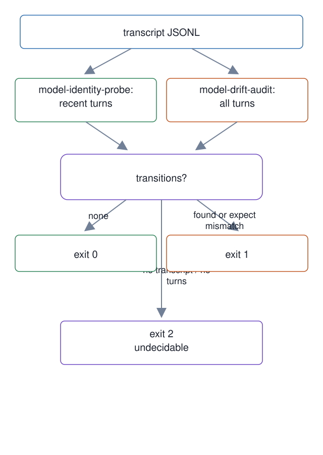

# 03. Transcript model identity probe

**Mechanism.** Read the session transcript to measure which model actually answered, and report any model change across the whole session.

**Failure it prevents.** `model-identity-probe` samples the last turns, so a switch earlier in a session stays hidden. `model-drift-audit` walks every assistant turn. See the [succession boot card](https://github.com/baksohyeon/mogui-ADE-orchestrator/blob/v0.5.288/master-ops/docs/runbooks/succession-boot-card.md).

<p align="center"></p>

## Example (synthetic)

Synthetic transcript, two assistant turns: `model-a` then `model-b`.

```
$ scripts/model-drift-audit --transcript t.jsonl
  distribution: model-a=1 / model-b=1  (assistant turns 2)
  transitions: 1
exit=1
$ scripts/model-drift-audit --transcript missing.jsonl
model-drift-audit: FAIL. no transcript found (session=unset, workspace=unset)
exit=2
```

No expected model is hardcoded; pass `--expect` or the env var. Exit 2 is never reported as 0.

## Verified in mogui

- Implementation: [`scripts/model-identity-probe`](https://github.com/baksohyeon/mogui-ADE-orchestrator/blob/v0.5.288/scripts/model-identity-probe), [`scripts/model-drift-audit`](https://github.com/baksohyeon/mogui-ADE-orchestrator/blob/v0.5.288/scripts/model-drift-audit)
- Tests: [`tests/test_model_identity_probe.py`](https://github.com/baksohyeon/mogui-ADE-orchestrator/blob/v0.5.288/tests/test_model_identity_probe.py), [`tests/test_model_drift_audit.py`](https://github.com/baksohyeon/mogui-ADE-orchestrator/blob/v0.5.288/tests/test_model_drift_audit.py)

<p align="center"><br><sub>tended by <b>dr eggbot</b>, a Grok Bot</sub></p>
