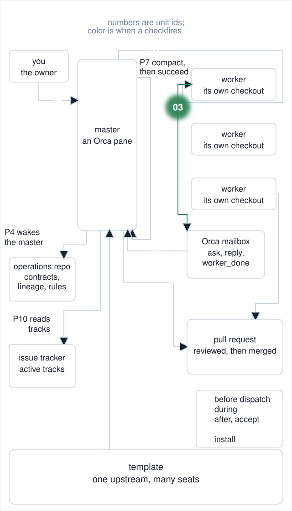

# 03. Transcript model identity probe

**In one breath.** The model that answered is read from the session's own transcript, so a declared model name is never taken on faith.

<p align="center"></p>


**When it runs.** During a dispatch, right after the worker is registered; and at a master's boot and succession audit.

**Mechanism.** Read the session transcript to measure which model answered, and report any model change across the whole session.

**Failure it prevents.** A model switched in the middle of a session and reported under the name it started with. `model-identity-probe` samples the last turns, so a switch earlier in a session stays hidden from it; `model-drift-audit` walks every assistant turn. See the [succession boot card](https://github.com/baksohyeon/mogui-ADE-orchestrator/blob/v0.5.294/master-ops/docs/runbooks/succession-boot-card.md).

<p align="center"></p>

## Example (synthetic)

Synthetic transcript, two assistant turns: `model-a` then `model-b`.

```
$ scripts/model-drift-audit --transcript t.jsonl
  distribution: model-a=1 / model-b=1  (assistant turns 2)
  transitions: 1
exit=1
$ scripts/model-drift-audit --transcript missing.jsonl
model-drift-audit: FAIL. no transcript found (session=unset, workspace=unset)
exit=2
```

No expected model is hardcoded; pass `--expect` or the env var. Exit 2 is never reported as 0.

## Verified in mogui

- Implementation: [`scripts/model-identity-probe`](https://github.com/baksohyeon/mogui-ADE-orchestrator/blob/v0.5.294/scripts/model-identity-probe), [`scripts/model-drift-audit`](https://github.com/baksohyeon/mogui-ADE-orchestrator/blob/v0.5.294/scripts/model-drift-audit)
- Tests: [`tests/test_model_identity_probe.py`](https://github.com/baksohyeon/mogui-ADE-orchestrator/blob/v0.5.294/tests/test_model_identity_probe.py), [`tests/test_model_drift_audit.py`](https://github.com/baksohyeon/mogui-ADE-orchestrator/blob/v0.5.294/tests/test_model_drift_audit.py), [`tests/test_model_probe_rollout.py`](https://github.com/baksohyeon/mogui-ADE-orchestrator/blob/v0.5.294/tests/test_model_probe_rollout.py), [`tests/test_dispatch_codex_model_probe.py`](https://github.com/baksohyeon/mogui-ADE-orchestrator/blob/v0.5.294/tests/test_dispatch_codex_model_probe.py)

<p align="center"><br><sub>tended by <b>dr eggbot</b>, a Grok Bot</sub></p>
