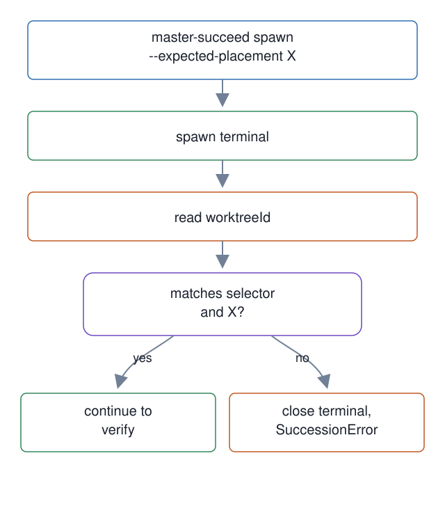

# 04. Master succession placement check

**In one breath.** A newly spawned master must land in the worktree it was meant for, or its terminal is closed.

**When it runs.** In the master lifecycle, at the moment a successor is spawned.

**Mechanism.** When a successor master is spawned, the terminal's reported worktree must match the requested and expected placement, or the new terminal is closed.

**Failure it prevents.** A successor that lands in the wrong worktree would run with the wrong cwd. The [succession boot card](https://github.com/baksohyeon/mogui-ADE-orchestrator/blob/v0.5.288/master-ops/docs/runbooks/succession-boot-card.md) requires the cwd to be the workspace root or a root the boot card explicitly approves.

<p align="center"></p>

## Example (synthetic)

Expected placement `X`, terminal reports `Y`:

```
spawn placement mismatch; closed terminal <handle>: expected X, got Y
```
`SuccessionError` carries exit code 26 for a placement mismatch, which `master-succeed` returns.

Relevant tests: `test_spawn_successor_expected_placement_mismatch_closes_terminal`, `test_cli_spawn_dry_run_outputs_expected_placement`.

## Verified in mogui

- Implementation: [`src/master_runtime/core/succession.py`](https://github.com/baksohyeon/mogui-ADE-orchestrator/blob/v0.5.288/src/master_runtime/core/succession.py), [`scripts/master-succeed`](https://github.com/baksohyeon/mogui-ADE-orchestrator/blob/v0.5.288/scripts/master-succeed), [`master-ops/docs/runbooks/succession-boot-card.md`](https://github.com/baksohyeon/mogui-ADE-orchestrator/blob/v0.5.288/master-ops/docs/runbooks/succession-boot-card.md)
- Tests: [`tests/test_succession.py`](https://github.com/baksohyeon/mogui-ADE-orchestrator/blob/v0.5.288/tests/test_succession.py), [`tests/test_succession_scenario.py`](https://github.com/baksohyeon/mogui-ADE-orchestrator/blob/v0.5.288/tests/test_succession_scenario.py)

<p align="center"><br><sub>tended by <b>dr eggbot</b>, a Grok Bot</sub></p>
