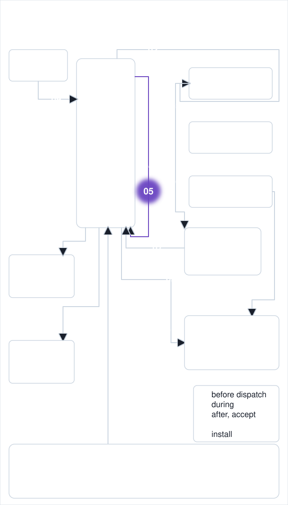
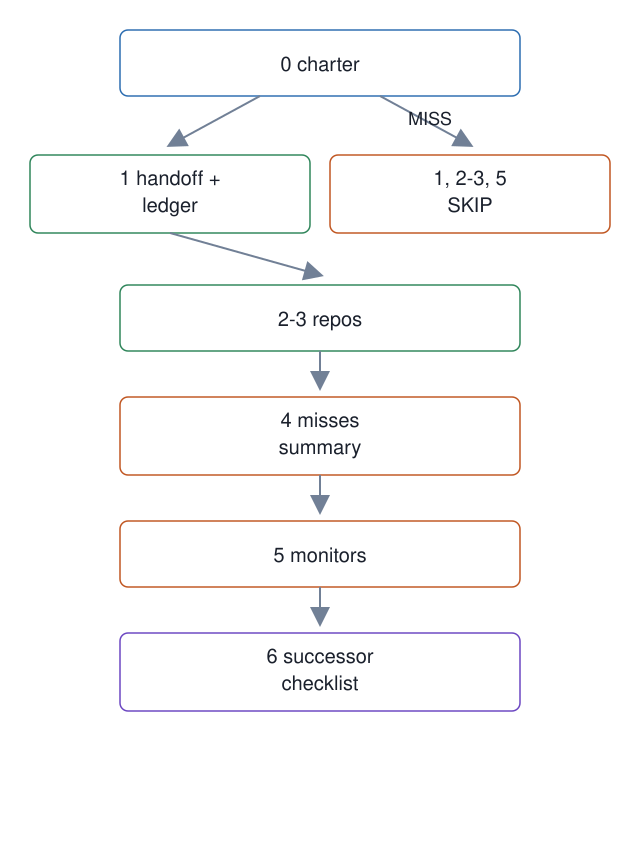

# 05. Read-only recovery flow

**In one breath.** A master recovering after an abnormal end re-reads its context in a fixed order and writes nothing while it does.

<p align="center"></p>


**When it runs.** In the master lifecycle, at a boot that follows an abnormal end.

**Mechanism.** `master-recover` runs the Recovery Flow, the numbered procedure a master follows after an abnormal end, steps 0 to 6, as reads only and prints one status line per step (OK, MISS, WARN, SKIP).

**Failure it prevents.** A new master acting on missing context. If step 0 (charter) misses, later steps are skipped fail-closed.

<p align="center"></p>

## Example (synthetic)

```
$ scripts/master-recover --charter nope.md --handoff nope2.md
0 MISS: Charter missing: nope.md
1 SKIP: fail-closed after step 0 MISS
2-3 SKIP: fail-closed after step 0 MISS
4 WARN: misses: step 0: Charter missing: nope.md; Trace Archive search is manual
5 SKIP: fail-closed after step 0 MISS
6 OK: successor verification checklist generated
exit=0
```

The command is a reporter, so it exits 0 whenever it ran; the verdict is in the step lines (or `--json`), and the fail-closed behavior is the `SKIP` after a `MISS`. `--handoff` names the predecessor's handoff note. Step 4 reports that the search of the Trace Archive, the history index of past sessions, is manual. The [ctx query doctrine](https://github.com/baksohyeon/mogui-ADE-orchestrator/blob/v0.5.294/master-ops/docs/runbooks/ctx-query-doctrine.md) says when that index must be queried and when it must not. Four generations of masters answered "I searched the files and found nothing" to questions whose answers sat in the conversation index.

## Verified in mogui

- Implementation: [`src/master_runtime/core/recovery.py`](https://github.com/baksohyeon/mogui-ADE-orchestrator/blob/v0.5.294/src/master_runtime/core/recovery.py), [`scripts/master-recover`](https://github.com/baksohyeon/mogui-ADE-orchestrator/blob/v0.5.294/scripts/master-recover)
- Tests: [`tests/test_recovery.py`](https://github.com/baksohyeon/mogui-ADE-orchestrator/blob/v0.5.294/tests/test_recovery.py), [`master-ops/scripts/test-tool-naming.sh`](https://github.com/baksohyeon/mogui-ADE-orchestrator/blob/v0.5.294/master-ops/scripts/test-tool-naming.sh) for the doctrine's rule that a tool is named, never described

<p align="center"><br><sub>tended by <b>dr eggbot</b>, a Grok Bot</sub></p>
