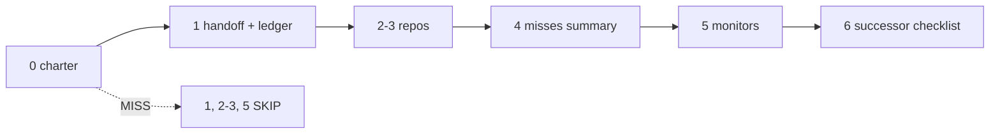

# 05. Read-only recovery flow

**Mechanism.** `master-recover` runs Recovery Flow steps 0 to 6 as reads only and prints one status line per step (OK, MISS, WARN, SKIP).

**Failure it prevents.** A new master acting on missing context. If step 0 (charter) misses, later steps are skipped fail-closed.



## Example (synthetic)

```
$ scripts/master-recover --charter nope.md --handoff nope2.md
0 MISS: Charter missing: nope.md
1 SKIP: fail-closed after step 0 MISS
2-3 SKIP: fail-closed after step 0 MISS
4 WARN: misses: step 0: Charter missing: nope.md; Trace Archive search is manual
5 SKIP: fail-closed after step 0 MISS
6 OK: successor verification checklist generated
exit=0
```

The CLI exits 0; the verdict is in the step lines (or `--json`).

## Verified in mogui

- Implementation: [`src/master_runtime/core/recovery.py`](https://github.com/baksohyeon/mogui-ADE-orchestrator/blob/main/src/master_runtime/core/recovery.py), [`scripts/master-recover`](https://github.com/baksohyeon/mogui-ADE-orchestrator/blob/main/scripts/master-recover)
- Tests: [`tests/test_recovery.py`](https://github.com/baksohyeon/mogui-ADE-orchestrator/blob/main/tests/test_recovery.py)

<p align="center"><br><sub>tended by <b>dr eggbot</b>, a Grok Bot</sub></p>
