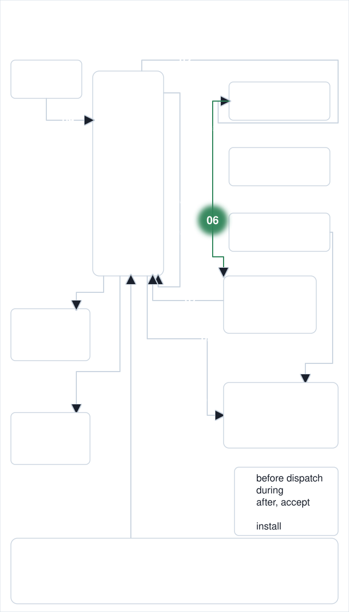
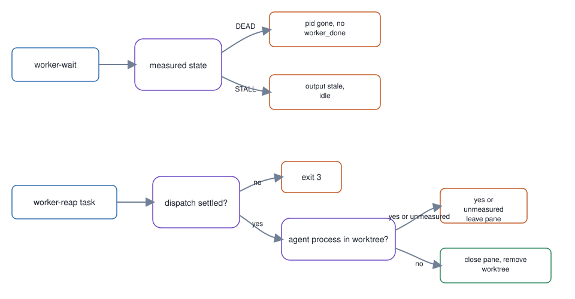

# 06. Worker wait and reap

**In one breath.** The master waits on its workers from measured state and closes a pane only when the worker is gone.

<p align="center"></p>


**When it runs.** During a dispatch, from the worker's launch to its pane being closed.

**Mechanism.** `worker-wait` waits on a Run's live dispatches and labels dead or stalled workers; `worker-reap` closes the terminal of a settled dispatch, one whose status is completed, accepted, failed, or abandoned, and cleans its worktree.

**Failure it prevents.** Closing a pane where a worker is still working, or treating a failed listing as an empty Run. A pane is closed only when it is listed, not claimed by a dispatched worker, and no agent CLI process has its cwd in the worktree.

<p align="center"></p>

## Example (synthetic)

`worker-reap` exit codes from the module docstring:

```
2 invalid invocation   3 not settled   4 malformed RPC JSON   5 no dispatch for task
```
`worker-wait` exits 2 when `orca` cannot produce an authoritative listing.

## Verified in mogui

- Implementation: [`src/master_runtime/core/worker_reap.py`](https://github.com/baksohyeon/mogui-ADE-orchestrator/blob/v0.5.294/src/master_runtime/core/worker_reap.py), [`scripts/worker-reap`](https://github.com/baksohyeon/mogui-ADE-orchestrator/blob/v0.5.294/scripts/worker-reap), [`master-ops/scripts/worker-wait`](https://github.com/baksohyeon/mogui-ADE-orchestrator/blob/v0.5.294/master-ops/scripts/worker-wait)
- Tests: [`tests/test_worker_reap.py`](https://github.com/baksohyeon/mogui-ADE-orchestrator/blob/v0.5.294/tests/test_worker_reap.py), [`tests/test_worker_wait.py`](https://github.com/baksohyeon/mogui-ADE-orchestrator/blob/v0.5.294/tests/test_worker_wait.py), [`master-ops/scripts/test-worker-wait.sh`](https://github.com/baksohyeon/mogui-ADE-orchestrator/blob/v0.5.294/master-ops/scripts/test-worker-wait.sh)

<p align="center"><br><sub>tended by <b>dr eggbot</b>, a Grok Bot</sub></p>
