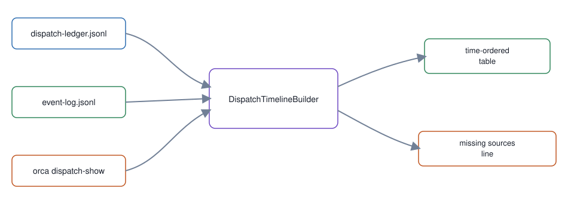

# 07. Dispatch timeline join

**In one breath.** Everything recorded about one dispatch, from three sources, is shown as one table in time order.

**When it runs.** During and after a dispatch, whenever the master asks what happened to one.

**Mechanism.** Join the dispatch ledger, the event log, and the live `dispatch-show` record for one dispatch into one time-ordered table.

**Failure it prevents.** Silence that looks the same as "nothing happened". A source with zero matching rows is named in `missing_sources`.

<p align="center"></p>

## Example (synthetic)

Empty ledger and event log, unknown id:

```
$ scripts/dispatch-timeline --ledger l.jsonl --event-log e.jsonl fake-id
TIMESTAMP   SOURCE   EVENT   OUTCOME   DETAIL
missing sources: ledger, event-log, dispatch-show
```

`--since` combined with an id exits 2. For a whole day instead of one dispatch, [`workstream-render.sh`](https://github.com/baksohyeon/mogui-ADE-orchestrator/blob/v0.5.288/master-ops/scripts/workstream-render.sh) renders the ledger into a readable workstream; it reads only.

## Verified in mogui

- Implementation: [`src/master_runtime/core/dispatch_timeline.py`](https://github.com/baksohyeon/mogui-ADE-orchestrator/blob/v0.5.288/src/master_runtime/core/dispatch_timeline.py), [`scripts/dispatch-timeline`](https://github.com/baksohyeon/mogui-ADE-orchestrator/blob/v0.5.288/scripts/dispatch-timeline), [its runbook](https://github.com/baksohyeon/mogui-ADE-orchestrator/blob/v0.5.288/master-ops/docs/runbooks/dispatch-timeline.md)
- Tests: [`tests/test_dispatch_timeline.py`](https://github.com/baksohyeon/mogui-ADE-orchestrator/blob/v0.5.288/tests/test_dispatch_timeline.py), [`master-ops/scripts/test-dispatch-timeline.sh`](https://github.com/baksohyeon/mogui-ADE-orchestrator/blob/v0.5.288/master-ops/scripts/test-dispatch-timeline.sh)

<p align="center"><br><sub>tended by <b>dr eggbot</b>, a Grok Bot</sub></p>
