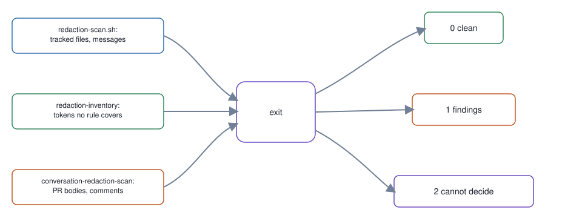

# 08. Scope-stating redaction scan

**In one breath.** Before a push, a scan looks for secrets and identifiers in the repository and in conversation surfaces, and says what it covered.

**When it runs.** After the work, before any push, in the map's "After / accept" group.

**Mechanism.** Scan tracked content, commit messages, and conversation surfaces for secrets and identifiers, state what was covered, and separate "cannot decide" from "clean".

**Failure it prevents.** Identifiers leaking where the repo scan did not look, such as PR bodies. See the [conversation redaction runbook](https://github.com/baksohyeon/mogui-ADE-orchestrator/blob/v0.5.294/master-ops/docs/runbooks/conversation-redaction.md).

<p align="center"></p>

## Example (synthetic)

```
$ scripts/redaction-scan.sh --repo-root ""
redaction-scan: --repo-root requires a path        exit=2
$ scripts/redaction-inventory      # REDACTION_EXTRA_PATTERNS unset
redaction-inventory: FAIL. REDACTION_EXTRA_PATTERNS is unset. ...   exit=2
```

gitleaks is the matching engine. Organization rules are supplied per checkout and are not in any repo. Conversation findings print the pattern class, never the matched value.

## Verified in mogui

- Implementation: [`scripts/redaction-scan.sh`](https://github.com/baksohyeon/mogui-ADE-orchestrator/blob/v0.5.294/scripts/redaction-scan.sh), [`scripts/redaction-inventory`](https://github.com/baksohyeon/mogui-ADE-orchestrator/blob/v0.5.294/scripts/redaction-inventory), [`master-ops/scripts/conversation-redaction-scan`](https://github.com/baksohyeon/mogui-ADE-orchestrator/blob/v0.5.294/master-ops/scripts/conversation-redaction-scan)
- Tests: [`tests/test_redaction_gate_coverage.py`](https://github.com/baksohyeon/mogui-ADE-orchestrator/blob/v0.5.294/tests/test_redaction_gate_coverage.py), [`tests/test_redaction_inventory.py`](https://github.com/baksohyeon/mogui-ADE-orchestrator/blob/v0.5.294/tests/test_redaction_inventory.py), [`tests/test_redaction_scan_commit_messages.py`](https://github.com/baksohyeon/mogui-ADE-orchestrator/blob/v0.5.294/tests/test_redaction_scan_commit_messages.py), [`tests/test_redaction_scan_engine_validation.py`](https://github.com/baksohyeon/mogui-ADE-orchestrator/blob/v0.5.294/tests/test_redaction_scan_engine_validation.py), [`tests/test_redaction_scan_native_script.py`](https://github.com/baksohyeon/mogui-ADE-orchestrator/blob/v0.5.294/tests/test_redaction_scan_native_script.py), [`tests/test_redaction_scan_python_override.py`](https://github.com/baksohyeon/mogui-ADE-orchestrator/blob/v0.5.294/tests/test_redaction_scan_python_override.py), [`tests/test_redaction_scan_repo_root.py`](https://github.com/baksohyeon/mogui-ADE-orchestrator/blob/v0.5.294/tests/test_redaction_scan_repo_root.py), [`master-ops/scripts/test-conversation-redaction-scan-glob-guard.sh`](https://github.com/baksohyeon/mogui-ADE-orchestrator/blob/v0.5.294/master-ops/scripts/test-conversation-redaction-scan-glob-guard.sh)

<p align="center"><br><sub>tended by <b>dr eggbot</b>, a Grok Bot</sub></p>
