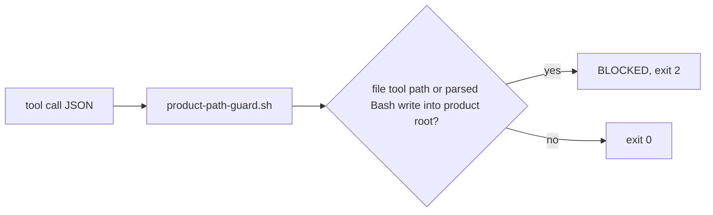

# 09. Product path write guard hook

**Mechanism.** A `PreToolUse(Edit|Write|NotebookEdit|Bash)` hook that blocks writes into a configured product repository root.

**Failure it prevents.** An agent writing into the product repo from the ops workspace. See the [product path guard runbook](https://github.com/baksohyeon/mogui-ADE-orchestrator/blob/main/master-ops/docs/runbooks/product-path-guard.md).



## Example (synthetic)

Runtime config lists `/tmp/pg/product` as a product root:

```
Bash "echo bad > /tmp/pg/product/file.txt"
[product-path-guard] BLOCKED: shell redirection is a write     exit=2
Bash "echo ok > /tmp/pg/note.txt"                               exit=0
```

Bash parsing is best effort. `MOGUI_PRODUCT_GUARD_FAIL_CLOSED=1` admits only commands in the read-only allowlist.

## Verified in mogui

- Implementation: [`master-ops/scripts/hooks/product-path-guard.sh`](https://github.com/baksohyeon/mogui-ADE-orchestrator/blob/main/master-ops/scripts/hooks/product-path-guard.sh), [`master-ops/docs/runbooks/product-path-guard.md`](https://github.com/baksohyeon/mogui-ADE-orchestrator/blob/main/master-ops/docs/runbooks/product-path-guard.md)
- Tests: [`master-ops/scripts/test-product-path-guard.sh`](https://github.com/baksohyeon/mogui-ADE-orchestrator/blob/main/master-ops/scripts/test-product-path-guard.sh)

<p align="center"><br><sub>tended by <b>dr eggbot</b>, a Grok Bot</sub></p>
