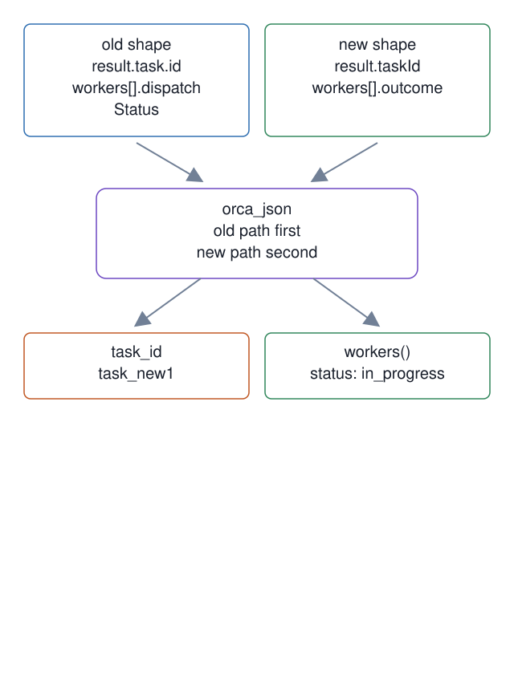

# 10. Orca JSON shape normalizer

**In one breath.** One module reads Orca's JSON in its old shape and its new one, so a renamed key cannot silently empty a value.

**When it runs.** Before dispatch and during, wherever a harness script reads Orca's JSON.

**Mechanism.** The `orca_json` module reads old nested keys first and newer top-level keys second. It normalizes worker statuses so old `dispatched` and new `in_progress` both report `in_progress`.

**Failure it prevents.** A shape change can leave one-off readers with an empty string or `None`. The module and its test keep each new path in one place.

<p align="center"></p>

## Example (synthetic)

```
# master-ops/scripts copied to /tmp/scripts
python3 -c 'import sys; sys.path.insert(0, sys.argv[1]); from lib import orca_json; print(orca_json.task_id({"taskId":"task_new1"}))' /tmp/scripts
task_new1
```

The shape change this module absorbs is also watched from the other side: [`orca-surface-check.sh`](https://github.com/baksohyeon/mogui-ADE-orchestrator/blob/v0.5.288/master-ops/scripts/orca-surface-check.sh) compares the installed Orca's version, schema, command count, and per-command digests against a stored baseline, and exits 0 unchanged, 1 drift, 2 unmeasurable.

## Verified in mogui

- Implementation: [`master-ops/scripts/lib/orca_json.py`](https://github.com/baksohyeon/mogui-ADE-orchestrator/blob/v0.5.288/master-ops/scripts/lib/orca_json.py), [`master-ops/docs/runbooks/orca-json.md`](https://github.com/baksohyeon/mogui-ADE-orchestrator/blob/v0.5.288/master-ops/docs/runbooks/orca-json.md), [`master-ops/scripts/dispatch`](https://github.com/baksohyeon/mogui-ADE-orchestrator/blob/v0.5.288/master-ops/scripts/dispatch)
- Tests: [`master-ops/scripts/test-orca-json.sh`](https://github.com/baksohyeon/mogui-ADE-orchestrator/blob/v0.5.288/master-ops/scripts/test-orca-json.sh)

<p align="center"><br><sub>tended by <b>dr eggbot</b>, a Grok Bot</sub></p>
