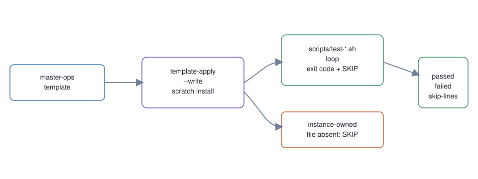

# 11. Rendered shell-test lane

**In one breath.** The template's shell tests run against a rendered copy, so a placeholder token cannot hide a failure.

**When it runs.** After a template change, in CI, in the map's "After / accept" group.

**Mechanism.** The `rendered-shell-tests` job renders `master-ops` into a scratch install with `template-apply --write`, the confirmation phrase piped in. It runs every rendered `scripts/test-*.sh` file and reports each exit code and `SKIP` line.

**Failure it prevents.** A shell test can pass while `{{...}}` tokens remain and fail after rendering. The lane also records when an instance-owned file is absent from a template-only checkout.

<p align="center"></p>

## Example (synthetic)

```
bash /tmp/ops/scripts/test-seat-check.sh
SKIP: ./scripts/harness-selfcheck.sh not found (instance-owned, not part of a template-only checkout)
```

## Verified in mogui

- Implementation: [`.github/workflows/gates.yml`](https://github.com/baksohyeon/mogui-ADE-orchestrator/blob/v0.5.294/.github/workflows/gates.yml), [`master-ops/scripts/template-apply`](https://github.com/baksohyeon/mogui-ADE-orchestrator/blob/v0.5.294/master-ops/scripts/template-apply)
- Tests: [`master-ops/scripts/test-seat-check.sh`](https://github.com/baksohyeon/mogui-ADE-orchestrator/blob/v0.5.294/master-ops/scripts/test-seat-check.sh), [`master-ops/scripts/test-template-currency-line.sh`](https://github.com/baksohyeon/mogui-ADE-orchestrator/blob/v0.5.294/master-ops/scripts/test-template-currency-line.sh), [`master-ops/scripts/test-contributing-shell-loop.sh`](https://github.com/baksohyeon/mogui-ADE-orchestrator/blob/v0.5.294/master-ops/scripts/test-contributing-shell-loop.sh), which pins the documented test loop to the files that exist

<p align="center"><br><sub>tended by <b>dr eggbot</b>, a Grok Bot</sub></p>
