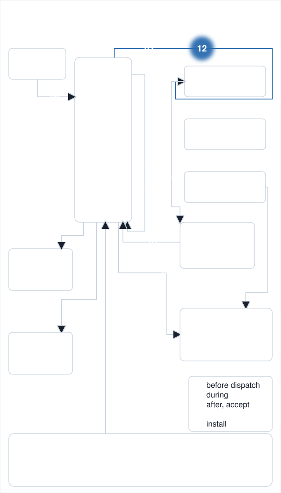
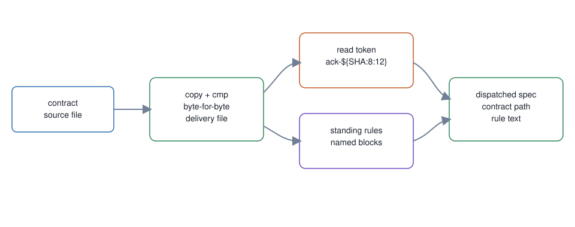

# 12. Contract delivery and read token

**In one breath.** The worker gets its contract as a verified copy with a token it must quote back, so the master knows the contract was read.

<p align="center"></p>


**When it runs.** Before dispatch, in the wrapper, after the gate.

**Mechanism.** With `--contract`, dispatch copies the contract to a delivery directory, compares the copy byte for byte, appends `ack-${SHA:8:12}`, and writes the delivered path into the spec. It then appends each standing-rule block the contract's front matter names.

**Failure it prevents.** A worker that never saw its contract and worked from the one-line spec. The token is a value only a worker that opened the delivered copy can produce. A missing standing-rules file exits 10 before dispatch, and a missing named block exits 3 during append.

<p align="center"></p>

## Example (synthetic)

```
SHA=abcdef0123456789beef; printf 'ack-%s\n' "${SHA:8:12}"
ack-23456789beef
```

The five shipped blocks are `headless`, `ack-token`, `placement`, `voice`, and `pr-house`. `headless` tells the worker not to background any command or start a watch and end its turn, and to poll in the foreground with a bounded loop. A seat adds its own blocks in `config/standing-rules.overlay.md`, which a re-stamp never touches. [`dispatch-smoke`](https://github.com/baksohyeon/mogui-ADE-orchestrator/blob/v0.5.294/master-ops/scripts/dispatch-smoke) is the seat-run end-to-end check of the wrapper's created-pane path, for the claude runtime only; its [runbook](https://github.com/baksohyeon/mogui-ADE-orchestrator/blob/v0.5.294/master-ops/docs/runbooks/dispatch-smoke.md) has the procedure.

## Verified in mogui

- Implementation: [`master-ops/scripts/dispatch`](https://github.com/baksohyeon/mogui-ADE-orchestrator/blob/v0.5.294/master-ops/scripts/dispatch), [`master-ops/rules/standing-rules.md`](https://github.com/baksohyeon/mogui-ADE-orchestrator/blob/v0.5.294/master-ops/rules/standing-rules.md), [`master-ops/docs/runbooks/contract-conventions.md`](https://github.com/baksohyeon/mogui-ADE-orchestrator/blob/v0.5.294/master-ops/docs/runbooks/contract-conventions.md)
- Tests: [`master-ops/scripts/test-dispatch-runtime.sh`](https://github.com/baksohyeon/mogui-ADE-orchestrator/blob/v0.5.294/master-ops/scripts/test-dispatch-runtime.sh), [`master-ops/scripts/test-dispatch-smoke.sh`](https://github.com/baksohyeon/mogui-ADE-orchestrator/blob/v0.5.294/master-ops/scripts/test-dispatch-smoke.sh), [`tests/test_dispatch_pane_classification.py`](https://github.com/baksohyeon/mogui-ADE-orchestrator/blob/v0.5.294/tests/test_dispatch_pane_classification.py) for the delivery verdict's pane classes, [`master-ops/scripts/test-dispatch-codex-prompt-marker.sh`](https://github.com/baksohyeon/mogui-ADE-orchestrator/blob/v0.5.294/master-ops/scripts/test-dispatch-codex-prompt-marker.sh) for the codex prompt marker against a captured pane, [`master-ops/scripts/test-dispatch-from-terminal.sh`](https://github.com/baksohyeon/mogui-ADE-orchestrator/blob/v0.5.294/master-ops/scripts/test-dispatch-from-terminal.sh) for the sender handle the wrapper passes to `task-create`

<p align="center"><br><sub>tended by <b>dr eggbot</b>, a Grok Bot</sub></p>
