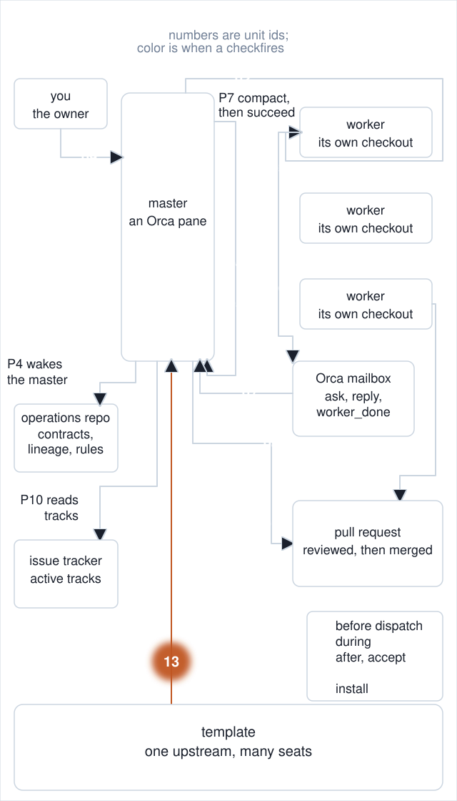
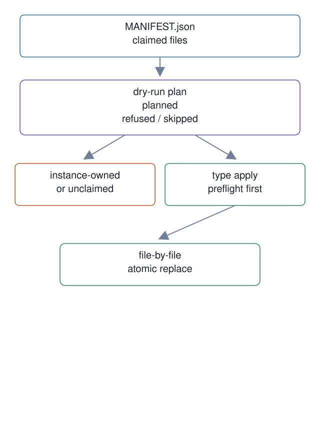

# 13. Template manifest and instance-owned paths

**In one breath.** An upgrade applies the template's files from a manifest and refuses the files the seat owns.

<p align="center"></p>


**When it runs.** After a template release, when a seat upgrades, in the map's "After / accept" group.

**Mechanism.** `template-apply` builds a manifest-based dry-run plan, refuses instance-owned and unclaimed paths, and asks for the phrase `apply` before writing. It replaces each file atomically after preflighting the planned sources and destinations.

**Failure it prevents.** An upgrade can overwrite `workspace-card/LOCAL.md` or `docs/runbooks/role-state.md`, or write a path the manifest never claimed. Missing template files and unresolved placeholders stop the write before confirmation.

<p align="center"></p>

## Example (synthetic)

```
python3 /tmp/ops/scripts/template-apply --ops /tmp/instance --template /tmp/template --attempt workspace-card/LOCAL.md --json  # --attempt is test-only
"action": "skipped-as-instance-owned"
```

## Verified in mogui

- Implementation: [`master-ops/scripts/template-apply`](https://github.com/baksohyeon/mogui-ADE-orchestrator/blob/v0.5.294/master-ops/scripts/template-apply), [`master-ops/scripts/template_common.py`](https://github.com/baksohyeon/mogui-ADE-orchestrator/blob/v0.5.294/master-ops/scripts/template_common.py), [`master-ops/MANIFEST.json`](https://github.com/baksohyeon/mogui-ADE-orchestrator/blob/v0.5.294/master-ops/MANIFEST.json), [`master-ops/TEMPLATE-VERSION`](https://github.com/baksohyeon/mogui-ADE-orchestrator/blob/v0.5.294/master-ops/TEMPLATE-VERSION)
- Tests: [`tests/test_template_check_apply.py`](https://github.com/baksohyeon/mogui-ADE-orchestrator/blob/v0.5.294/tests/test_template_check_apply.py), [`tests/test_template_apply_card_extension.py`](https://github.com/baksohyeon/mogui-ADE-orchestrator/blob/v0.5.294/tests/test_template_apply_card_extension.py), [`tests/test_placeholder_fill_sentinels.py`](https://github.com/baksohyeon/mogui-ADE-orchestrator/blob/v0.5.294/tests/test_placeholder_fill_sentinels.py), which proves a founding fill replaces every documented placeholder

<p align="center"><br><sub>tended by <b>dr eggbot</b>, a Grok Bot</sub></p>
