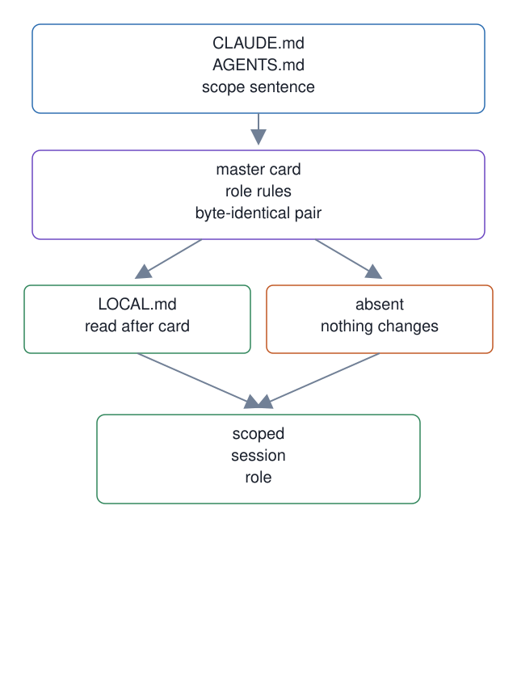

# 14. Workspace card scope and LOCAL.md

**In one breath.** The session card says who it is for, keeps its two files identical, and lets a seat add local rules in a separate file.

**When it runs.** In the master lifecycle, at every session start that reads the card.

**Mechanism.** The session card, the `CLAUDE.md` and `AGENTS.md` at the workspace root, opens with a sentence naming whom it applies to: the owner-appointed master and the workers it dispatches. It keeps the two card files byte-identical and reads optional instance-owned `LOCAL.md` after the card without overriding its rules.

**Failure it prevents.** A dispatched worker, or a session from another workspace, claiming the master role because the card did not say whom it addresses. The card keeps a seat's additions in `LOCAL.md` beside it, and the template never overwrites that file.

<p align="center"></p>

## Example (synthetic)

```
test -e /tmp/ops/workspace-card/LOCAL.md || echo 'When it is absent, nothing changes.'
When it is absent, nothing changes.
```

## Verified in mogui

- Implementation: [`master-ops/workspace-card/CLAUDE.md`](https://github.com/baksohyeon/mogui-ADE-orchestrator/blob/v0.5.294/master-ops/workspace-card/CLAUDE.md), [`master-ops/workspace-card/AGENTS.md`](https://github.com/baksohyeon/mogui-ADE-orchestrator/blob/v0.5.294/master-ops/workspace-card/AGENTS.md), [`master-ops/workspace-card/README.md`](https://github.com/baksohyeon/mogui-ADE-orchestrator/blob/v0.5.294/master-ops/workspace-card/README.md)
- Tests: [`master-ops/scripts/test-workspace-card-scope.sh`](https://github.com/baksohyeon/mogui-ADE-orchestrator/blob/v0.5.294/master-ops/scripts/test-workspace-card-scope.sh), [`tests/test_template_apply_card_extension.py`](https://github.com/baksohyeon/mogui-ADE-orchestrator/blob/v0.5.294/tests/test_template_apply_card_extension.py)

<p align="center"><br><sub>tended by <b>dr eggbot</b>, a Grok Bot</sub></p>
