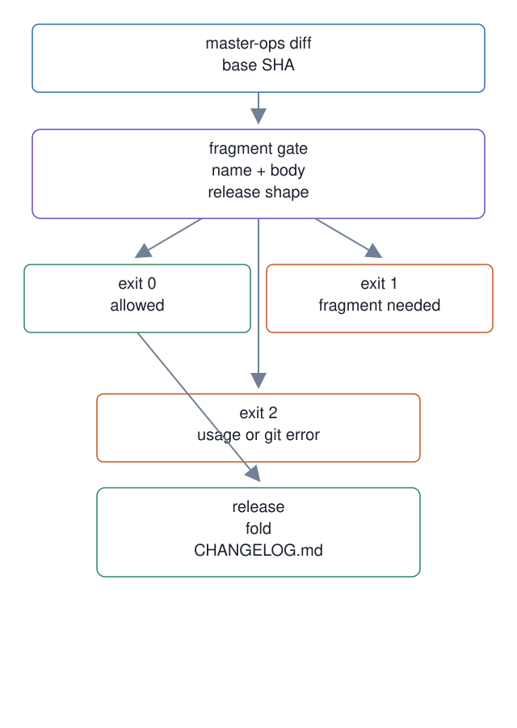

# 15. Changelog fragment gate

**Mechanism.** The fragment gate requires a dated root file under `master-ops/changelog.d/` for a `master-ops/` change outside that directory. The release script folds fragments into `CHANGELOG.md` when a release is cut.

**Failure it prevents.** A pull request with an operations change can fail when its fragment is absent, empty, or badly named. A release-shaped diff has its documented exemption, and merged fragments remain until release folding.

<p align="center"></p>

## Example (synthetic)

```
scripts/changelog-fragment-check abc123
changelog-fragment-check: master-ops/ changed outside changelog.d/ with no added fragment; add master-ops/changelog.d/<YYYY-MM-DD>-<slug>.md
exit=1
```

## Verified in mogui

- Implementation: [`scripts/changelog-fragment-check`](https://github.com/baksohyeon/mogui-ADE-orchestrator/blob/v0.5.288/scripts/changelog-fragment-check), [`scripts/changelog-release`](https://github.com/baksohyeon/mogui-ADE-orchestrator/blob/v0.5.288/scripts/changelog-release), [`master-ops/changelog.d/README.md`](https://github.com/baksohyeon/mogui-ADE-orchestrator/blob/v0.5.288/master-ops/changelog.d/README.md), [`gates.yml`](https://github.com/baksohyeon/mogui-ADE-orchestrator/blob/v0.5.288/.github/workflows/gates.yml)
- Tests: [`scripts/test-changelog-fragment-check.sh`](https://github.com/baksohyeon/mogui-ADE-orchestrator/blob/v0.5.288/master-ops/scripts/test-changelog-fragment-check.sh), [`tests/test_changelog_release.py`](https://github.com/baksohyeon/mogui-ADE-orchestrator/blob/v0.5.288/tests/test_changelog_release.py)

<p align="center"><br><sub>tended by <b>dr eggbot</b>, a Grok Bot</sub></p>
