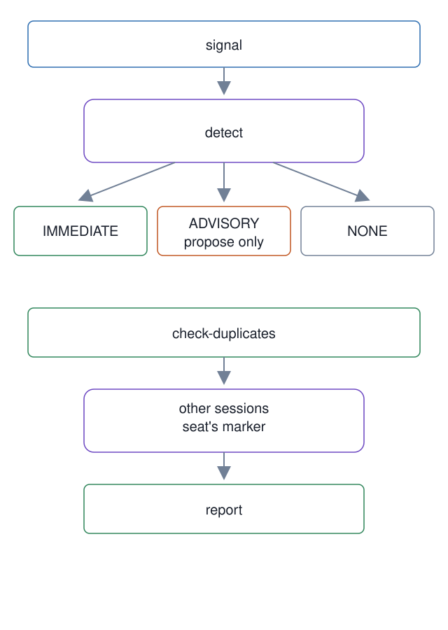

# 16. Succession triggers and duplicate masters

**In one breath.** Succession has one entry point, `master-succeed`, with six subcommands: classify the trigger, build the handoff (the thin file a successor boots from), verify the successor, find duplicate masters, retire the predecessor, and spawn. The trigger classifier can only propose; the duplicate check and the empty-seat rule keep two masters from holding one seat.

**When it runs.** In the master lifecycle: at every boot (the duplicate check is part of the boot comparison set), and from the owner's word to succeed until the predecessor is measured gone.

**Mechanism.** `detect` classifies a signal into three outcomes. Five explicit phrases, in English and Korean, give `IMMEDIATE`. A context ratio of 0.60 or more, or a named milestone, gives `ADVISORY`, and the report carries the sentence "Auto-succession is not permitted; propose succession only." Anything else gives `NONE`. `verify-successor` reads the recovery report of unit [05](../05-read-only-recovery-flow/): one `MISS` makes it `FAILED`; otherwise it counts three checks (open tracks recited, baseline matched, monitors rearmed) and reports `PASS` for all three, `PARTIAL` for fewer. `check-duplicates` lists Orca's terminals and returns every session that carries the seat's marker except the caller's own handle. Before a founding spawn, the onboarding spawn step lists the seat's terminals and proceeds only when there are zero. `retire` and `spawn` are covered by unit [04](../04-master-succession-placement-check/) and [one master generation](../../walkthroughs/02-one-master-generation.md).

The lineage module, `lineage.py`, validates the 13 required fields of an entry and rejects a generation number that already exists. After a write it re-reads the file to prove the write was append-only, and restores the previous bytes when it was not. At `v0.5.294` it is a tested library with no caller: no script imports it, and the lineage entries the walkthrough describes are written by hand.

**Failure it prevents.** Two masters in one seat, each believing it is the only one. A successor that reports a clean boot while a recovery step missed. Context pressure turning into an automatic succession the owner never asked for.

<p align="center"></p>

## Example (synthetic)

```
$ scripts/master-succeed detect "routine status update" --context-ratio 0.7 --json
{"message":"Context ratio is high. Auto-succession is not permitted; propose succession only.","reason":"context ratio threshold reached","status":"ADVISORY"}
$ scripts/master-succeed detect "승계 진행해" --json
{"message":"","reason":"explicit succession instruction","status":"IMMEDIATE"}
```

An `ADVISORY` result is a sentence for the owner. Nothing in the harness acts on it.

## Verified in mogui

- Implementation: [`scripts/master-succeed`](https://github.com/baksohyeon/mogui-ADE-orchestrator/blob/v0.5.294/scripts/master-succeed), [`src/master_runtime/core/succession.py`](https://github.com/baksohyeon/mogui-ADE-orchestrator/blob/v0.5.294/src/master_runtime/core/succession.py) (`detect_trigger`, `verify_successor`, `detect_duplicate_instances`), [`src/master_runtime/core/lineage.py`](https://github.com/baksohyeon/mogui-ADE-orchestrator/blob/v0.5.294/src/master_runtime/core/lineage.py), [`master-ops/docs/runbooks/boot-comparison-set.md`](https://github.com/baksohyeon/mogui-ADE-orchestrator/blob/v0.5.294/master-ops/docs/runbooks/boot-comparison-set.md), [`master-ops/onboarding/09-spawn.md`](https://github.com/baksohyeon/mogui-ADE-orchestrator/blob/v0.5.294/master-ops/onboarding/09-spawn.md)
- Tests: [`tests/test_succession.py`](https://github.com/baksohyeon/mogui-ADE-orchestrator/blob/v0.5.294/tests/test_succession.py), [`tests/test_succession_scenario.py`](https://github.com/baksohyeon/mogui-ADE-orchestrator/blob/v0.5.294/tests/test_succession_scenario.py), [`tests/test_lineage.py`](https://github.com/baksohyeon/mogui-ADE-orchestrator/blob/v0.5.294/tests/test_lineage.py)

<p align="center"><br><sub>tended by <b>dr eggbot</b>, a Grok Bot</sub></p>
