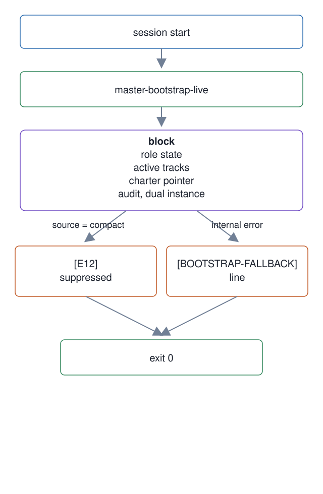

# 17. Master boot block and the live SessionStart hook

**In one breath.** At every session start a hook prints a small block: the role state, the active tracks from the issue tracker, a pointer to the charter, and whether another master is running. It never fails the boot, and after a compaction it holds the role and the tracks back so recall can be measured first.

**When it runs.** In the master lifecycle, at every session start, including the start that follows a compaction. Two smaller hooks run beside it: one injects the role state and the execution rule on every prompt, one warns when the issue tracker does not resolve from the workspace root.

**Mechanism.** `master-bootstrap` is the static loader. It reads the charter and the handoff into a budget of 24,000 characters and marks what it cut with `[TRUNCATED:...]`. It parses the role state and runs a non-owning check for a second master process. `master-bootstrap-live` is the hook entry point around it. It emits a block headed `[MASTER-BOOTSTRAP v1]` with sections for role state, active tracks, and the charter pointer, then a `[BD-PRIME-AUDIT]` line about the tracker's memory block, a `[DUAL-INSTANCE]` line, and alerts. Every problem becomes an `[AUDIT-ALERT]` or `[BUDGET-ALERT]` line inside the block; the block itself is capped at 1,000 characters, tracks truncated first. When the session source is `compact`, the role-state and active-tracks sections are replaced by one `[E12]` line that says they were suppressed for the recall probe. A banner then tells the master to read the canonical role-state file before any tool action. Any internal error is reduced to a `[BOOTSTRAP-FALLBACK]` line, and the exit code is always 0.

`role-state-inject.sh` prints the current role, the lock, and the execution rule on every prompt, to counter autonomy defaults a host injects. `tracker-check.sh` warns at session start when the tracker does not resolve to the operations repository, a failure that is otherwise silent. Both write one line per firing to the hook fire log.

**Failure it prevents.** A master that boots with another master's context, with no role, or with a stale tracker and does not notice. A compaction that looks like continuity because the hook handed the answers back before the recall probe asked its questions.

<p align="center"></p>

## Example (synthetic)

```
[MASTER-BOOTSTRAP v1]
## Role State
Current Role: Maintenance
Role Lock: ENABLED
## Active tracks
- mg-101 P1 dispatch wrapper: delivery verdict for codex panes
## Charter
Operations SSOT: see the ops repository MASTER-OPERATIONS.md (Role State canon)
[BD-PRIME-AUDIT] memories=12
[DUAL-INSTANCE] none
```

After a compaction the two sections above give way to one line: `[E12] compact: tracks/role suppressed for recall probe (recall first, then check against the tracker for the authoritative state)`.

## Verified in mogui

- Implementation: [`scripts/master-bootstrap`](https://github.com/baksohyeon/mogui-ADE-orchestrator/blob/v0.5.288/scripts/master-bootstrap), [`src/master_runtime/core/bootstrap.py`](https://github.com/baksohyeon/mogui-ADE-orchestrator/blob/v0.5.288/src/master_runtime/core/bootstrap.py), [`scripts/master-bootstrap-live`](https://github.com/baksohyeon/mogui-ADE-orchestrator/blob/v0.5.288/scripts/master-bootstrap-live), [`src/master_runtime/core/bootstrap_live.py`](https://github.com/baksohyeon/mogui-ADE-orchestrator/blob/v0.5.288/src/master_runtime/core/bootstrap_live.py), [`master-ops/scripts/hooks/role-state-inject.sh`](https://github.com/baksohyeon/mogui-ADE-orchestrator/blob/v0.5.288/master-ops/scripts/hooks/role-state-inject.sh), [`master-ops/scripts/hooks/tracker-check.sh`](https://github.com/baksohyeon/mogui-ADE-orchestrator/blob/v0.5.288/master-ops/scripts/hooks/tracker-check.sh), [charter §8](https://github.com/baksohyeon/mogui-ADE-orchestrator/blob/v0.5.288/master-ops/docs/charter/08-boot-hooks-observability.md)
- Tests: [`tests/test_bootstrap.py`](https://github.com/baksohyeon/mogui-ADE-orchestrator/blob/v0.5.288/tests/test_bootstrap.py), [`tests/test_bootstrap_live.py`](https://github.com/baksohyeon/mogui-ADE-orchestrator/blob/v0.5.288/tests/test_bootstrap_live.py), [`tests/test_role_state_execution_rule.py`](https://github.com/baksohyeon/mogui-ADE-orchestrator/blob/v0.5.288/tests/test_role_state_execution_rule.py), [`master-ops/scripts/test-tracker-check-banner.sh`](https://github.com/baksohyeon/mogui-ADE-orchestrator/blob/v0.5.288/master-ops/scripts/test-tracker-check-banner.sh)

<p align="center"><br><sub>tended by <b>dr eggbot</b>, a Grok Bot</sub></p>
