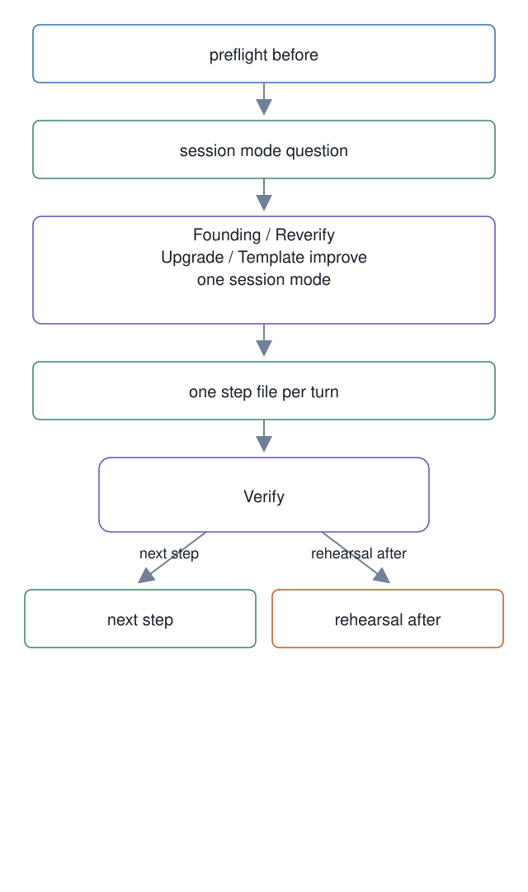

# 18. Progressive onboarding and install checks

**In one breath.** A new workspace is installed by an agent that reads one step file per turn and opens the next only after the current step's checks pass. Before it starts, a preflight measures what the machine has; after it finishes, a rehearsal measures what the install can do, and reports a gap wherever it cannot measure.

**When it runs.** At install time, before the first master exists, and again whenever an install is re-verified. The map's four groups start after this; the install is the step that produces the seat they run on.

**Mechanism.** `master-ops/ONBOARDING.md` is a router. Its first act is to ask the owner which of four session modes this is. Founding is a new workspace. Reverify is a health check only, with spawning blocked. Upgrade brings the template forward, also with spawning blocked. Template improve is work on the template itself, not an install at all. It then loads one file under `onboarding/` per step, eleven steps from orientation to the installer's own retirement, and the next file opens only after the current step's Verify list passes. The step files are terse; the owner-facing turns are not, and the router forbids a list of technical words in owner speech.

`onboarding-preflight.sh` runs the checks that decide what the harness can do at all. They cover Orca and its orchestration surface, the agent CLI, the worker runtime, the tracker, Python, gitleaks, the history index, the organization redaction rules, and the skill stack. A check named in `PREFLIGHT_WAIVE` is downgraded from fail to warn, and every waiver is printed and counted. `onboarding-rehearsal` is the read-only post-install check: it reports `GAP` when a postcondition cannot be measured, never repairs anything, and keeps host paths out of its report. `spawn-test` goes further: it creates sandboxes, clones the repository, launches real installer agents per runtime, and collects the transcripts and orchestration round-trips as evidence. `generate-manifest` writes the manifest the template upgrade of unit [13](../13-template-manifest-instance-owned-paths/) depends on, and holds the one executable list of files that stay on the template side. `labels-create` replays the repository's label set onto a new repository, since labels do not travel with a template.

**Failure it prevents.** An installer that reads every step at once and either drowns or improvises, both measured on 2026-08-03. An install declared healthy because nothing complained, when nothing had been measured. A second master spawned into a seat that already had one.

<p align="center"></p>

## Example (synthetic)

```
$ PREFLIGHT_WAIVE=ctx scripts/onboarding-preflight.sh
PASS orca            orca status reports a usable runtime
PASS bd              bd 0.9 resolves from the workspace root
WARN ctx             waived by PREFLIGHT_WAIVE (was FAIL: ctx not on PATH)
...
```

A waiver is a line in the output and a count in the summary, and the summary repeats every essential check that failed with its consequence. It is never silent.

## Verified in mogui

- Implementation: [`master-ops/ONBOARDING.md`](https://github.com/baksohyeon/mogui-ADE-orchestrator/blob/v0.5.294/master-ops/ONBOARDING.md), [`scripts/onboarding-preflight.sh`](https://github.com/baksohyeon/mogui-ADE-orchestrator/blob/v0.5.294/scripts/onboarding-preflight.sh), [`master-ops/scripts/onboarding-rehearsal`](https://github.com/baksohyeon/mogui-ADE-orchestrator/blob/v0.5.294/master-ops/scripts/onboarding-rehearsal), [`master-ops/scripts/spawn-test`](https://github.com/baksohyeon/mogui-ADE-orchestrator/blob/v0.5.294/master-ops/scripts/spawn-test), [`scripts/generate-manifest`](https://github.com/baksohyeon/mogui-ADE-orchestrator/blob/v0.5.294/scripts/generate-manifest), [`scripts/labels-create`](https://github.com/baksohyeon/mogui-ADE-orchestrator/blob/v0.5.294/scripts/labels-create), [spawn-test runbook](https://github.com/baksohyeon/mogui-ADE-orchestrator/blob/v0.5.294/master-ops/docs/runbooks/spawn-test-harness.md)
- Tests: [`tests/test_onboarding_preflight.py`](https://github.com/baksohyeon/mogui-ADE-orchestrator/blob/v0.5.294/tests/test_onboarding_preflight.py), [`tests/test_onboarding_rehearsal.py`](https://github.com/baksohyeon/mogui-ADE-orchestrator/blob/v0.5.294/tests/test_onboarding_rehearsal.py), [`tests/test_onboarding_structure.py`](https://github.com/baksohyeon/mogui-ADE-orchestrator/blob/v0.5.294/tests/test_onboarding_structure.py), [`tests/test_generate_manifest.py`](https://github.com/baksohyeon/mogui-ADE-orchestrator/blob/v0.5.294/tests/test_generate_manifest.py), [`master-ops/scripts/test-spawn-test.sh`](https://github.com/baksohyeon/mogui-ADE-orchestrator/blob/v0.5.294/master-ops/scripts/test-spawn-test.sh), [`tests/test_github_config.py`](https://github.com/baksohyeon/mogui-ADE-orchestrator/blob/v0.5.294/tests/test_github_config.py) for the label set

<p align="center"><br><sub>tended by <b>dr eggbot</b>, a Grok Bot</sub></p>
