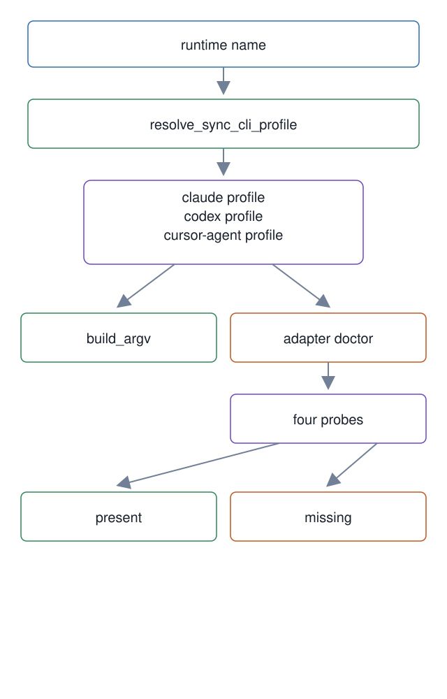

# 19. Adapter layer: tool-neutral worker profiles

**In one breath.** Every vendor-specific flag for running a worker's CLI lives in one profile class per runtime, behind one neutral interface. A doctor command measures which tools are installed by running each one's own probe.

**When it runs.** Before dispatch, when the harness needs the command line that runs one prompt on a given runtime; and at install or re-verification, when `adapter doctor` is run.

**Mechanism.** `SyncCliProfile` is the interface: one method, `build_argv`, returns the argument list that runs one prompt to completion on a synchronous CLI, with an optional model. Three reference profiles ship: Claude Code (`claude -p <prompt> --model <m>`), Codex in one-shot mode (`codex exec --model <m> <prompt>`), and the Cursor agent. `resolve_sync_cli_profile` returns the profile for a runtime name or `None` for an unknown one, and `sync_cli_runtimes` lists the known names. The doctor runs four checks, each a real probe command: `git --version`, `node --version`, `orca status --json`, and `bd --version`. The Orca probe is `status --json` on purpose: `orca --version` does not exist, printed a usage banner and exited 0 on one host, and launched the application on a Linux host, so it passed while proving nothing. The report lists present and missing tools with the probe that decided each.

**Failure it prevents.** A vendor flag spreading into the core modules, so that adding a runtime means editing the dispatcher. A tool check that passes because the command exited 0 without checking anything.

<p align="center"></p>

## Example (synthetic)

```
$ scripts/adapter doctor
{
  "missing": ["node"],
  "present": ["git", "orca", "bd"],
  "results": [
    {"name": "orca", "present": true, "detail": "exit 0", "probe_cmd": ["orca", "status", "--json"], "path": null},
    ...
  ]
}
```

## Verified in mogui

- Implementation: [`scripts/adapter`](https://github.com/baksohyeon/mogui-ADE-orchestrator/blob/v0.5.288/scripts/adapter), [`src/master_runtime/core/adapter/profile.py`](https://github.com/baksohyeon/mogui-ADE-orchestrator/blob/v0.5.288/src/master_runtime/core/adapter/profile.py), [`src/master_runtime/core/adapter/doctor.py`](https://github.com/baksohyeon/mogui-ADE-orchestrator/blob/v0.5.288/src/master_runtime/core/adapter/doctor.py)
- Tests: the adapter has no test file of its own at `v0.5.288`; `scripts/adapter doctor` is one of the three commands the repository README offers for trying the core without setup.

<p align="center"><br><sub>tended by <b>dr eggbot</b>, a Grok Bot</sub></p>
