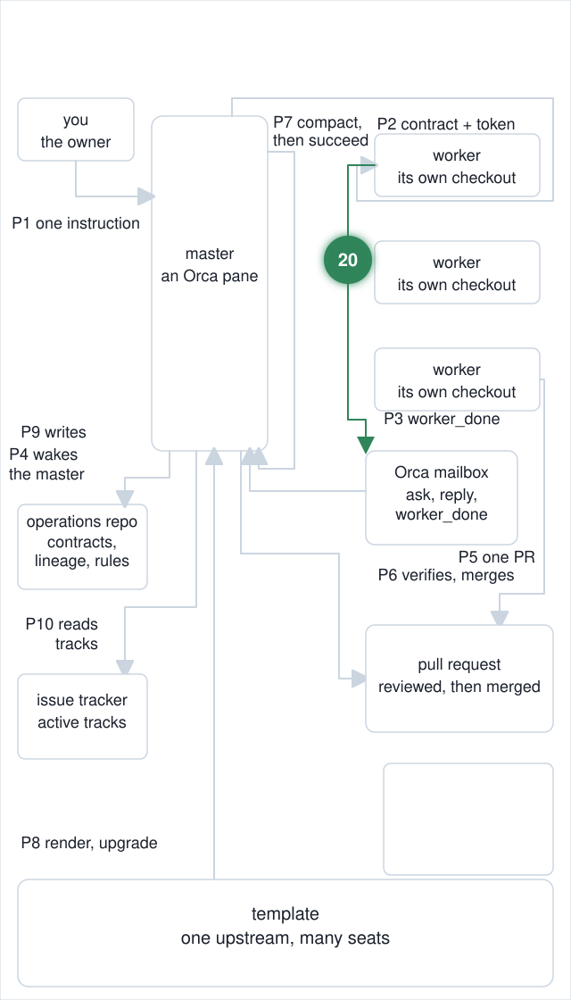
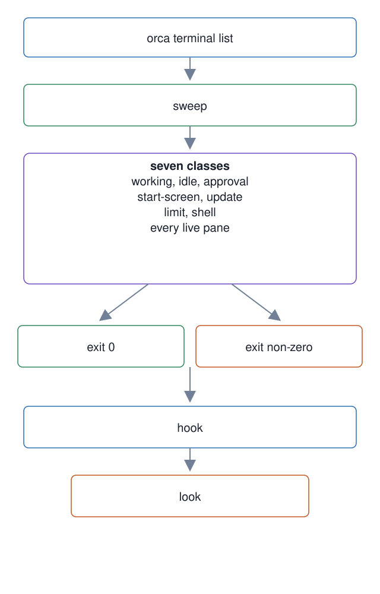

# 20. Blocked-worker detection and dispatch authority

**In one breath.** A worker waiting on a prompt sends no message and lands no commit, so its silence reads as progress. A sweep classifies every live pane into seven states, a per-turn hook tells the master when a pane needs a decision, and one script answers the codex hook-review modal under the master's own authority.

<p align="center"></p>


**When it runs.** During a dispatch: the hook on every prompt the master submits, the sweep whenever the master runs it, the modal answer at a codex worker's launch.

**Mechanism.** `worker-pane-sweep` reads every pane Orca lists, excluding the master's own, and prints one verdict per pane from seven classes: `working`, `idle`, `approval`, `start-screen`, `update`, `limit`, `shell`. Each class needs a different answer. The script is a classifier only: it exits non-zero when any pane needs a decision and never acts, because acting on a misread pane is how a start screen gets text fired into it. The approval markers it matches live in one shared file, `approval-prompt-markers.txt`, read by the sweep and by the hook. Two separate lists once drifted apart, and the sweep read a blocked pane as idle for two days. `worker-block-warn.sh` runs on every prompt the master submits, classifies from the pane previews one `orca terminal list` already returns, and decides only whether to look. `orch-inbox-warn.sh` warns once when unacknowledged orchestration messages exist. `codex-hooks-review-answer` handles one measured case: codex opens a modal asking to trust the installed hooks, Orca's wait reports `agent-hooks-review-prompt`, a keystroke is refused, and the script re-issues it the way Orca prescribes. Clearing a prompt inside the contract's scope is dispatch authority under charter §4, so these are the master's job.

**Failure it prevents.** A worker stuck on an approval prompt for hours while the master polls the inbox and the pull request, both of which stay quiet, until the owner clears it by hand. Measured on 2026-08-06, twice in one day.

<p align="center"></p>

## Example (synthetic)

```
# shape only: one line per live pane; the master's own pane is labeled and skipped
$ master-ops/scripts/worker-pane-sweep
self   coordinator   term_7f3e2d1c-0000  this session
ok     working       term_7f3e2d1c-0001  esc to interrupt
ACT    approval      term_7f3e2d1c-0002  do you want to proceed? 1. yes
ACT    start-screen  term_7f3e2d1c-0003  resume session
exit=1
```

Two panes need a decision; the exit code says so, and the script leaves both alone.

## Verified in mogui

- Implementation: [`master-ops/scripts/worker-pane-sweep`](https://github.com/baksohyeon/mogui-ADE-orchestrator/blob/v0.5.294/master-ops/scripts/worker-pane-sweep), [`master-ops/scripts/approval-prompt-markers.txt`](https://github.com/baksohyeon/mogui-ADE-orchestrator/blob/v0.5.294/master-ops/scripts/approval-prompt-markers.txt), [`master-ops/scripts/hooks/worker-block-warn.sh`](https://github.com/baksohyeon/mogui-ADE-orchestrator/blob/v0.5.294/master-ops/scripts/hooks/worker-block-warn.sh), [`master-ops/scripts/hooks/orch-inbox-warn.sh`](https://github.com/baksohyeon/mogui-ADE-orchestrator/blob/v0.5.294/master-ops/scripts/hooks/orch-inbox-warn.sh), [`master-ops/scripts/codex-hooks-review-answer`](https://github.com/baksohyeon/mogui-ADE-orchestrator/blob/v0.5.294/master-ops/scripts/codex-hooks-review-answer), [charter §4](https://github.com/baksohyeon/mogui-ADE-orchestrator/blob/v0.5.294/master-ops/docs/charter/04-worker-routing-review.md), [orch-inbox-warn runbook](https://github.com/baksohyeon/mogui-ADE-orchestrator/blob/v0.5.294/master-ops/docs/runbooks/orch-inbox-warn.md)
- Tests: [`master-ops/scripts/test-worker-pane-sweep.sh`](https://github.com/baksohyeon/mogui-ADE-orchestrator/blob/v0.5.294/master-ops/scripts/test-worker-pane-sweep.sh), [`master-ops/scripts/test-worker-block-warn.sh`](https://github.com/baksohyeon/mogui-ADE-orchestrator/blob/v0.5.294/master-ops/scripts/test-worker-block-warn.sh), [`master-ops/scripts/test-codex-hooks-review-answer.sh`](https://github.com/baksohyeon/mogui-ADE-orchestrator/blob/v0.5.294/master-ops/scripts/test-codex-hooks-review-answer.sh)

<p align="center"><br><sub>tended by <b>dr eggbot</b>, a Grok Bot</sub></p>
