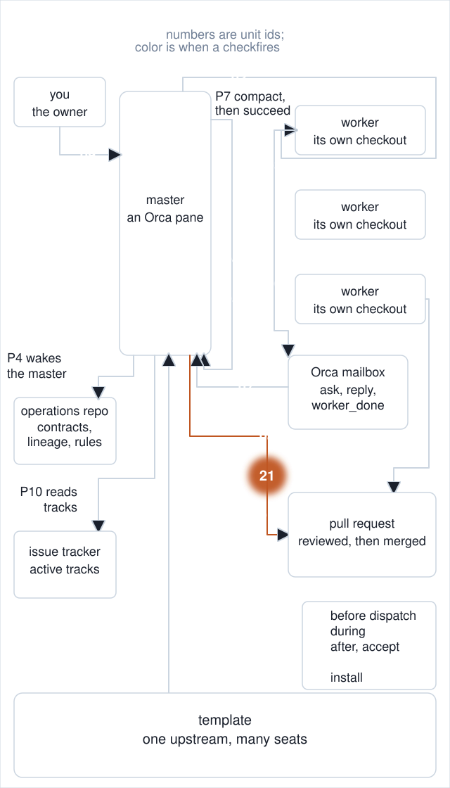
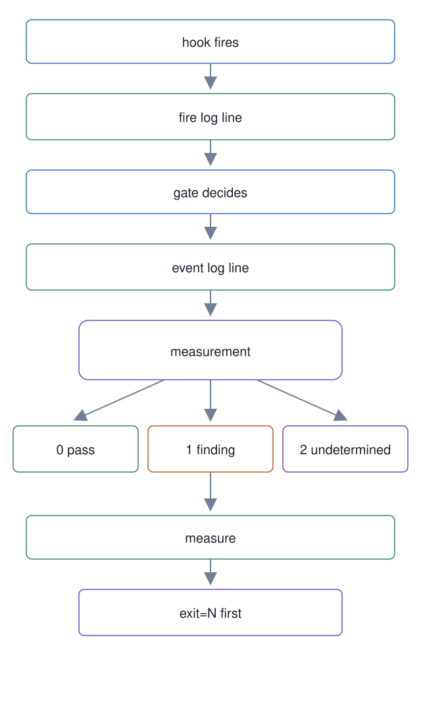

# 21. Hook fire log, event log, and the exit-code vocabulary

**In one breath.** Every hook writes one line when it fires, every gate decision writes one line to a second log, and every script that measures something maps its result to the same three exit codes: 0 pass, 1 finding, 2 undetermined. A wrapper puts a command's exit status on the first line of its output, where it cannot be skipped.

<p align="center"></p>


**When it runs.** Before, during, and after a dispatch, in every hook and gate; the reports are read by hand when the master asks which hooks fire and what the guard rejects.

**Mechanism.** The fire log, `~/.mogui/hook-fire-log.jsonl`, takes one JSON line per hook invocation: timestamp, hook name, event, working directory, runtime hint, session kind (master, worker, unknown), and verdict (`pass`, `warn`, `block`, `skip`, `override`). `hook-coverage-report` turns it into a matrix of hook by runtime and session kind, with the last firing and a count per cell. The event log, `~/.mogui/event-log.jsonl`, is separate and takes decision events with value-free fields only: event name, outcome, evidence, reason, command class, target scope. Raw commands, absolute paths, and credentials are forbidden in it, and `mogui_log.py` scrubs secret shapes and home paths before a line is written. `measure-product-path-guard.sh` reads it and reports the guard's Bash rejection rate, or `N/A (0/0; no command observations)` when there is nothing to count.

`mogui_errors.py` names the vocabulary: `EXIT_PASS`, `EXIT_FINDING`, `EXIT_UNDETERMINED` are 0, 1, 2, and the error types carry them, so a gate denial is exit 1 and a measurement that could not finish is exit 2. `gate_runner.py` wraps a measurement, maps pass, finding, and unknown to those codes, and turns any unexpected exception into undetermined. `measure` is the affordance for the reader of all of this: it runs a command, prints `exit=<status>` first on its own line, prints `(no output)` for empty output, and exits with the command's own status.

**Failure it prevents.** Four commands read without their exit status in one day, 2026-08-04: an empty listing reported as zero branches, a scan that matched nothing reported as nine dead workers. A wired hook that never fires and a hook that is not wired look the same until something records the firing.

<p align="center"></p>

## Example (synthetic)

```
$ master-ops/scripts/measure git ls-remote --heads origin
exit=128
(no output)
```

```
{"ts":1722728400,"hook":"worker-block-warn","event":"UserPromptSubmit","cwd":"~/example-workspace","runtime_hint":"claude","session_kind":"master","verdict":"warn"}
```

## Verified in mogui

- Implementation: [`master-ops/scripts/mogui_log.py`](https://github.com/baksohyeon/mogui-ADE-orchestrator/blob/v0.5.294/master-ops/scripts/mogui_log.py), [`master-ops/scripts/mogui_errors.py`](https://github.com/baksohyeon/mogui-ADE-orchestrator/blob/v0.5.294/master-ops/scripts/mogui_errors.py), [`master-ops/scripts/gate_runner.py`](https://github.com/baksohyeon/mogui-ADE-orchestrator/blob/v0.5.294/master-ops/scripts/gate_runner.py), [`master-ops/scripts/measure`](https://github.com/baksohyeon/mogui-ADE-orchestrator/blob/v0.5.294/master-ops/scripts/measure), [`master-ops/scripts/hook-coverage-report`](https://github.com/baksohyeon/mogui-ADE-orchestrator/blob/v0.5.294/master-ops/scripts/hook-coverage-report), [`master-ops/scripts/measure-product-path-guard.sh`](https://github.com/baksohyeon/mogui-ADE-orchestrator/blob/v0.5.294/master-ops/scripts/measure-product-path-guard.sh), [hook fire observability runbook](https://github.com/baksohyeon/mogui-ADE-orchestrator/blob/v0.5.294/master-ops/docs/runbooks/hook-fire-observability.md), [error and logging runbook](https://github.com/baksohyeon/mogui-ADE-orchestrator/blob/v0.5.294/master-ops/docs/runbooks/error-and-logging.md)
- Tests: [`tests/test_mogui_log.py`](https://github.com/baksohyeon/mogui-ADE-orchestrator/blob/v0.5.294/tests/test_mogui_log.py), [`master-ops/scripts/test-mogui-logging.sh`](https://github.com/baksohyeon/mogui-ADE-orchestrator/blob/v0.5.294/master-ops/scripts/test-mogui-logging.sh), [`master-ops/scripts/test-hook-verdict.sh`](https://github.com/baksohyeon/mogui-ADE-orchestrator/blob/v0.5.294/master-ops/scripts/test-hook-verdict.sh), [`master-ops/scripts/test-measure.sh`](https://github.com/baksohyeon/mogui-ADE-orchestrator/blob/v0.5.294/master-ops/scripts/test-measure.sh)

<p align="center"><br><sub>tended by <b>dr eggbot</b>, a Grok Bot</sub></p>
