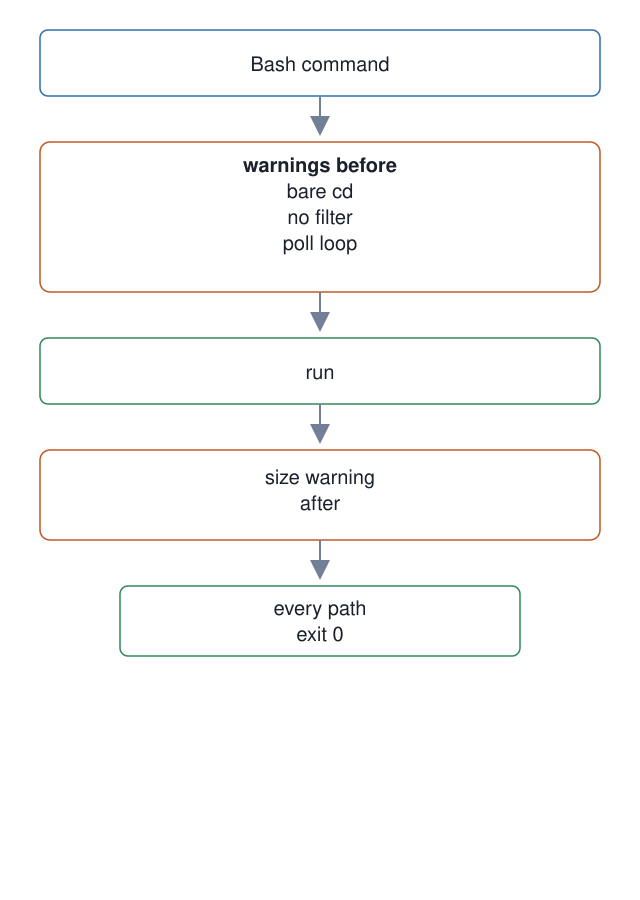

# 23. Advisory Bash hooks

**In one breath.** Four hooks watch the master's shell commands and say one line when a habit is about to cost context or correctness. None of them blocks; each exits 0 and writes its verdict to the fire log.

**When it runs.** Before and during a dispatch, on the master's Bash tool calls: three before a command runs, one after it returns.

**Mechanism.** `bash-bare-cd-warn.sh` warns when a command starts with a bare `cd`, since the workspace card says the shell stays at the workspace root. `bash-output-trim-warn.sh` looks at the command string before it runs and warns when a command known for large output has no filter after it. `bash-output-size-warn.sh` measures the result after the fact and warns once when it exceeds 6,000 characters, about 1,500 tokens. It exists because the trim hook goes quiet the moment any filter token appears; one session spent 24 percent of its context on Bash results without a warning. `bash-poll-warn.sh` detects hand-rolled polling: `while` with `sleep`, chained sleeps, loop state checks. The master should wait on Orca's mailbox instead, as the [Orca primer](../../concepts/orca-primer.md) explains.

**Failure it prevents.** A session that fills its own context with unread command output, and a master that polls in a script and takes the mail that was meant to wake it.

<p align="center"></p>

## Example (synthetic)

```
# shape only: the fire-log line a warning leaves behind; the hook's own output is one sentence naming the size
{"ts":1722728401,"hook":"bash-output-size-warn","event":"PostToolUse","cwd":"~/example-workspace","runtime_hint":"claude","session_kind":"master","verdict":"warn"}
```

## Verified in mogui

- Implementation: [`master-ops/scripts/hooks/bash-bare-cd-warn.sh`](https://github.com/baksohyeon/mogui-ADE-orchestrator/blob/v0.5.294/master-ops/scripts/hooks/bash-bare-cd-warn.sh), [`master-ops/scripts/hooks/bash-output-trim-warn.sh`](https://github.com/baksohyeon/mogui-ADE-orchestrator/blob/v0.5.294/master-ops/scripts/hooks/bash-output-trim-warn.sh), [`master-ops/scripts/hooks/bash-output-size-warn.sh`](https://github.com/baksohyeon/mogui-ADE-orchestrator/blob/v0.5.294/master-ops/scripts/hooks/bash-output-size-warn.sh), [`master-ops/scripts/hooks/bash-poll-warn.sh`](https://github.com/baksohyeon/mogui-ADE-orchestrator/blob/v0.5.294/master-ops/scripts/hooks/bash-poll-warn.sh)
- Tests: [`master-ops/scripts/test-bash-output-size-warn.sh`](https://github.com/baksohyeon/mogui-ADE-orchestrator/blob/v0.5.294/master-ops/scripts/test-bash-output-size-warn.sh); the other three hooks have no test file of their own at `v0.5.294`.

<p align="center"><br><sub>tended by <b>dr eggbot</b>, a Grok Bot</sub></p>
