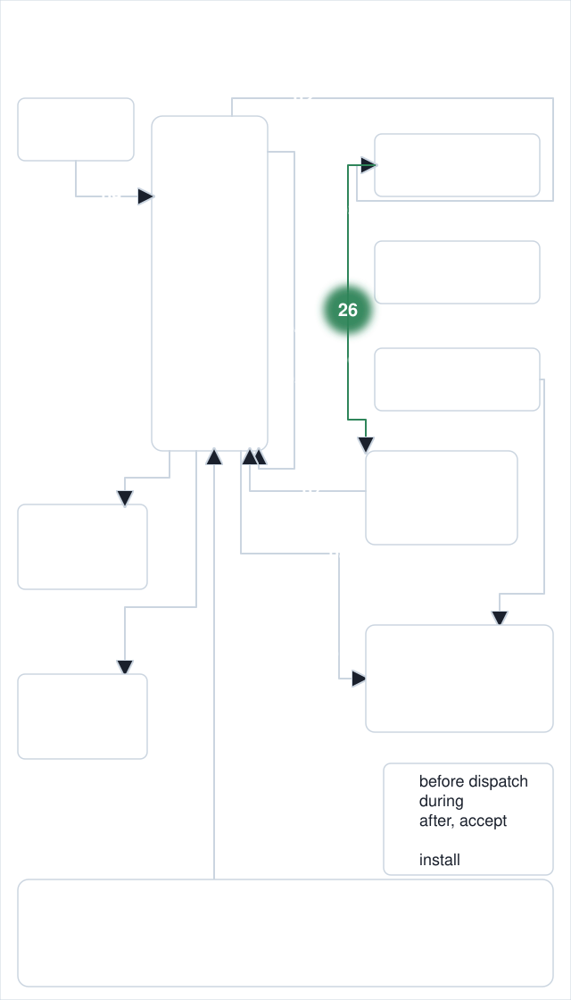
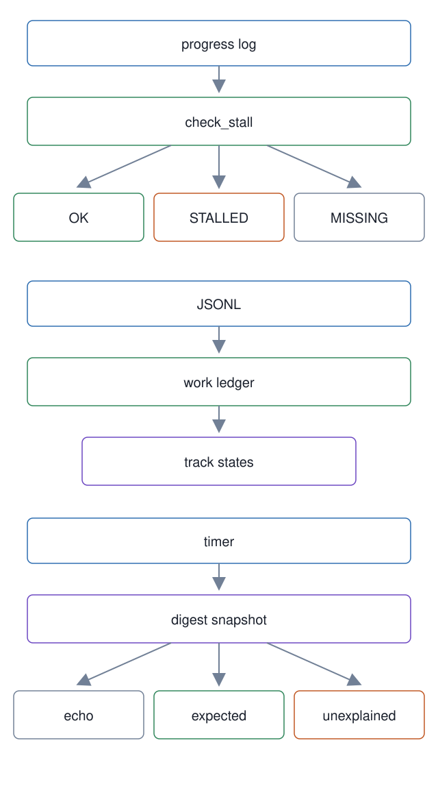

# 26. Stall watchdog, work ledger, and the digest loop

**In one breath.** Three small modules watch work from the outside. The watchdog says whether a worker's progress log has gone idle past a threshold. The work ledger replays a workspace's tracks from an append-only JSONL file. The digest loop takes a read-only snapshot of repositories, jobs, and processes on a timer and classifies each change as echo, expected, or unexplained.

<p align="center"></p>


**When it runs.** During a dispatch for the watchdog, through `dispatch-gate watch`. In the master lifecycle for the work ledger, when the recovery flow of unit [05](../05-read-only-recovery-flow/) replays active tracks. The digest loop runs on its own timer, ten minutes when something is active and thirty when nothing is.

**Mechanism.** `watchdog.check_stall` reads a progress log's modification time, or the timestamps a caller's predicate extracts from its lines. It returns `OK`, `STALLED` past 360 seconds of idleness by default, or `MISSING` with the reason `LOG_MISSING` when the log does not exist. `dispatch-gate watch` is its command-line face, next to `report`, which prints the ledger's view of a dispatch. `JsonlWorkLedger` keeps one `TrackState` per track (status from `REGISTERED` on, references, a note, timestamps) and replays the file into the current state; `WorkspaceRuntime` holds the session cache around it. `l1-digest` runs the digest loop: it collects a `Snapshot` of configured repositories, job logs, and processes, triages every observed change against a saved baseline, renders a Markdown digest, and suggests the next interval. A job log is `running`, `stalled`, `dormant`, `finished`, or `missing`; a change is `echo` when the loop caused it, `expected` when the baseline predicted it, `unexplained` otherwise.

**Failure it prevents.** A worker that stopped writing an hour ago and still counts as running. A master that recovers with no record of which tracks were open. A change in a repository or a process nobody asked for, noticed only by chance.

<p align="center"></p>

## Example (synthetic)

```
# shape only: the stall decision's fields
$ scripts/dispatch-gate watch --log ~/example-workspace/.mogui/worker-ex-101.log --max-idle 360
{"status":"STALLED","idle_seconds":912.4,"last_progress_at":1762500000.0,"reason":"STALLED"}
```

## Verified in mogui

- Implementation: [`src/master_runtime/core/watchdog.py`](https://github.com/baksohyeon/mogui-ADE-orchestrator/blob/v0.5.294/src/master_runtime/core/watchdog.py), [`src/master_runtime/core/work_ledger.py`](https://github.com/baksohyeon/mogui-ADE-orchestrator/blob/v0.5.294/src/master_runtime/core/work_ledger.py), [`src/master_runtime/core/digest_loop.py`](https://github.com/baksohyeon/mogui-ADE-orchestrator/blob/v0.5.294/src/master_runtime/core/digest_loop.py), [`scripts/l1-digest`](https://github.com/baksohyeon/mogui-ADE-orchestrator/blob/v0.5.294/scripts/l1-digest), the `watch` and `report` subcommands of [`scripts/dispatch-gate`](https://github.com/baksohyeon/mogui-ADE-orchestrator/blob/v0.5.294/scripts/dispatch-gate)
- Tests: [`tests/test_work_ledger.py`](https://github.com/baksohyeon/mogui-ADE-orchestrator/blob/v0.5.294/tests/test_work_ledger.py), [`tests/test_digest_loop.py`](https://github.com/baksohyeon/mogui-ADE-orchestrator/blob/v0.5.294/tests/test_digest_loop.py), [`tests/test_dispatch_gate.py`](https://github.com/baksohyeon/mogui-ADE-orchestrator/blob/v0.5.294/tests/test_dispatch_gate.py)

<p align="center"><br><sub>tended by <b>dr eggbot</b>, a Grok Bot</sub></p>
