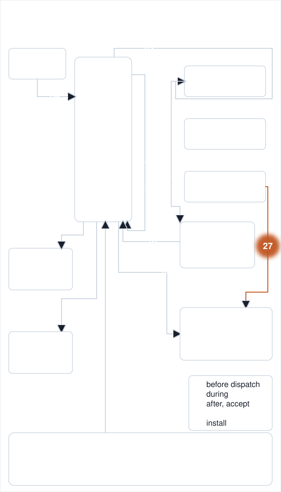
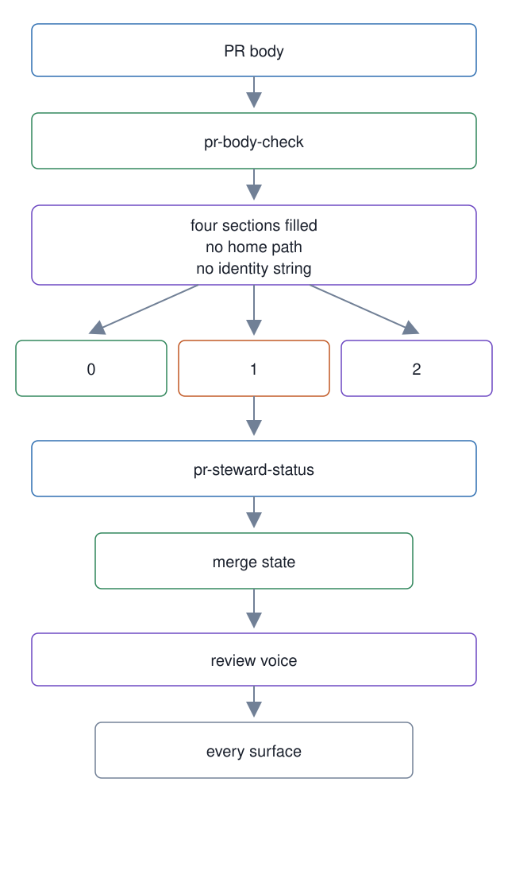

# 27. Pull request stewardship

**In one breath.** A pull request body has four required sections that must be filled, not left as template text, and must carry no home path or identity string. One script checks that; one reports a pull request's merge state without guessing about gate reruns; one runbook fixes how the workspace writes on every public surface.

<p align="center"></p>


**When it runs.** After the work, in the map's "After / accept" group. A worker opens the pull request under the `voice` and `pr-house` rule blocks; the master verifies it in step 14 of [one dispatch](../../walkthroughs/01-one-dispatch.md).

**Mechanism.** `pr-body-check <pr>` reads the body and requires four headings, Problem, Why this approach, What this changes, Expected effect, each with text under it that differs from the template's guidance. It also scans the body for absolute home paths and identity-bearing strings. Exit 0 means filled and clean, 1 means a section is missing, empty, or unmodified, or a redaction finding, 2 is a usage or runtime error. `pr-steward-status <pr>` reports the merge stewardship state of a pull request from GitHub's data, under one constraint written into the script: do not infer that a gate was re-run from API data. The review-voice runbook has eleven rules, fixed on 2026-08-03. The first seven are for review surfaces. Keep the body current with the branch as it stands. Reference the code line and offer a suggestion block. Be courteous and expect to be wrong sometimes. A review is not an accusation. Fault the interface or the system, never the person or the bot. Run the anti-slop self-check before sending. Keep tracker ids and codenames out of titles. Rules 8 to 11 apply to every surface the workspace writes on, chat with the owner included. Given a correction, write the corrected sentence and stop. Never "not A but B". Home paths render as `~`. A correction carries no citation. Blame records are public by genre and name the accountable role and generation, never a person, a path, a pid, or a handle. The `voice` standing-rule block carries the runbook's rules into a worker's task text.

**Failure it prevents.** A pull request whose body still says what the template told the author to write. A home path pushed in a body the repository scan never looked at. A fresh install that received the review procedure and none of the voice, which happened until 2026-08-05 because the voice lived only in the tracker's memory.

<p align="center"></p>

## Example (synthetic)

```
# shape only: one finding per line, then the exit code
$ master-ops/scripts/pr-body-check 42 --repo example-org/example-product
Expected effect: section present but unmodified from the template
exit=1
```

## Verified in mogui

- Implementation: [`master-ops/scripts/pr-body-check`](https://github.com/baksohyeon/mogui-ADE-orchestrator/blob/v0.5.294/master-ops/scripts/pr-body-check), [`master-ops/scripts/pr-steward-status`](https://github.com/baksohyeon/mogui-ADE-orchestrator/blob/v0.5.294/master-ops/scripts/pr-steward-status), [review voice runbook](https://github.com/baksohyeon/mogui-ADE-orchestrator/blob/v0.5.294/master-ops/docs/runbooks/review-voice.md), [pr-body-check runbook](https://github.com/baksohyeon/mogui-ADE-orchestrator/blob/v0.5.294/master-ops/docs/runbooks/pr-body-check.md), the `voice` block in [`master-ops/rules/standing-rules.md`](https://github.com/baksohyeon/mogui-ADE-orchestrator/blob/v0.5.294/master-ops/rules/standing-rules.md)
- Tests: [`master-ops/scripts/test-pr-body-check-redaction.sh`](https://github.com/baksohyeon/mogui-ADE-orchestrator/blob/v0.5.294/master-ops/scripts/test-pr-body-check-redaction.sh)

<p align="center"><br><sub>tended by <b>dr eggbot</b>, a Grok Bot</sub></p>
