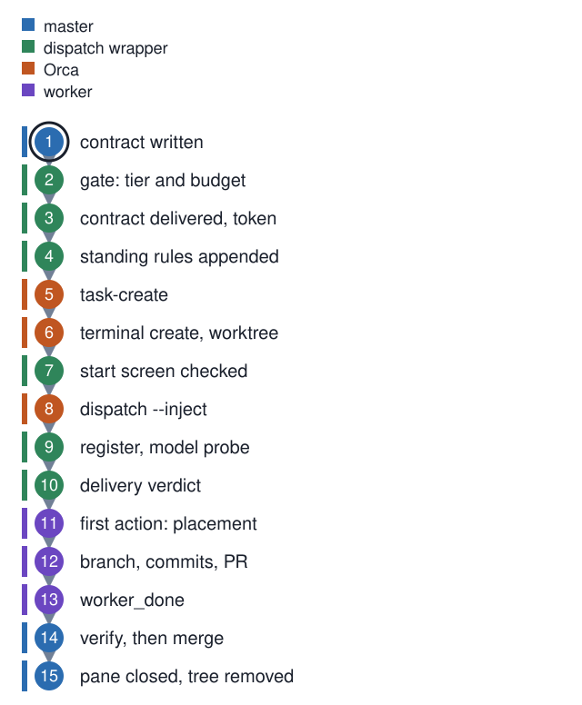

# One dispatch, from the owner's word to a closed pane

**In one breath.** The owner says go. The master writes a contract and hands it to a wrapper script. The wrapper checks a gate, delivers the contract with a read token, asks Orca for a task, a terminal, and a dispatch, then reports what it could and could not verify. The worker proves where it stands, does the work, opens a pull request, and sends `worker_done`. The master verifies on its own and closes the pane.

Fifteen steps. The diagram below moves a ring from step to step; every label is readable with the animation off.

<p align="center"></p>

Two programs share this page. Orca is the program the harness runs inside: it owns terminals, worktrees, and the mailbox between the master and its workers (Orca's own word for the master is coordinator). The harness is a set of scripts that run on top of it. The [Orca primer](../concepts/orca-primer.md) draws the line between the two. This page follows one dispatch across it. The steps are this page's numbering; the section numbers quoted along the way are the numbered comments in the wrapper's source, so each step can be found in the file.

## Step 1. Contract written (master)

The master never edits a product repository. It writes a contract file. The front matter names the tier, the runtime, the repository, a budget, the paths the worker may write, and the standing rule blocks to append. The body holds the task in prose, a "done means" list, and a FIRST ACTION block, three lines in which the worker reports where it landed before it works (step 11 shows them). The clauses come from [contract conventions](https://github.com/baksohyeon/mogui-ADE-orchestrator/blob/v0.5.288/master-ops/docs/runbooks/contract-conventions.md), and each clause there names the incident that made it necessary. The contract is committed to the operations repository before it is dispatched, so its hash is a fact of record.

## Steps 2 to 4. The wrapper, before Orca is asked for anything

The master runs one command:

```
scripts/dispatch --contract contracts/2026-11-07-example-task.md \
  --spec "<one paragraph: repository, branch, base sha, the change, done means>" \
  --worktree path:<absolute path of the worker's worktree>
```

The wrapper is [`master-ops/scripts/dispatch`](https://github.com/baksohyeon/mogui-ADE-orchestrator/blob/v0.5.288/master-ops/scripts/dispatch). Its first three sections run before any Orca call. The lines below are what it printed on one seat on 2026-11-07; a seat is one installed copy of the harness, with its own values filled in. Identifiers are replaced by synthetic ones and the model name by `model-a`. The wrapper prints Korean words on four of its lines; this table gives them before the output does.

| printed | meaning |
|---|---|
| `계약` | contract; the eight characters after it are the first eight of the contract's hash |
| `신규`, `재사용` | new, reused: whether Orca opened a pane or the master passed an existing one |
| `원장대조` | ledger reconciliation, the name of the model-probe job |
| `transcript실측` | measured from the transcript |

```
model derived for runtime codex from tier policy: model-a
pre-trust ✓ codex · Summary: 3 added, 0 updated, 1 already trusted
⚙ gate ✓ efficient · model-a · est 3.0k · 계약 9b8a7c6d
📄 contract delivered · ~/.mogui/dispatch-contracts/9b8a7c6d-2026-11-07-example-task.md · read-token required
📎 standing rules · headless ack-token placement voice pr-house
```

**Step 2, the gate.** Section 1 of the script does three things. It derives the model from the tier policy when the caller named none. It pre-trusts the worktree for the runtime, so the worker does not stop on a trust prompt that reads as idle; one script per runtime does this ([`claude-worker-pretrust`](https://github.com/baksohyeon/mogui-ADE-orchestrator/blob/v0.5.288/scripts/claude-worker-pretrust), [`codex-worker-pretrust`](https://github.com/baksohyeon/mogui-ADE-orchestrator/blob/v0.5.288/scripts/codex-worker-pretrust), [`cursor-worker-pretrust`](https://github.com/baksohyeon/mogui-ADE-orchestrator/blob/v0.5.288/scripts/cursor-worker-pretrust)). The counts on the `pre-trust` line are the trust entries it added, updated, and found already present. It evaluates the dispatch gate: tier, budget, routing, and an estimate of the spec size. `efficient` is the tier the policy put the model in; the shipped policy has two tiers, `top` and `efficient`. The wrapper refuses a top-tier model until the master passes the owner's answer with `--top-approved "<reason>"`. Unit [02](../units/02-dispatch-tier-fanout-gate/) covers the gate on its own.

**Step 3, delivery and the read token.** Section 1.5 copies the contract to a delivery directory outside every repository and compares the copy with the original byte for byte. It then appends a read token, built from characters of the hash that the output never shows; the standing rule that governs it is named `ack-token`. The worker must type that token bare in its completion message. A worker that only saw the path cannot produce it. Unit [12](../units/12-contract-delivery-read-token/) has the mechanism and the exit codes.

**Step 4, standing rules.** Section 1.6 reads the five named blocks from [`rules/standing-rules.md`](https://github.com/baksohyeon/mogui-ADE-orchestrator/blob/v0.5.288/master-ops/rules/standing-rules.md) and appends their text to the spec. The worker receives "you are headless" and "report a placement verdict, never a path" as part of its own task text. A missing rules file exits 10 before anything is dispatched.

## Steps 5 to 8. Four Orca calls

```
→ task_0a1b2c3d4e5f → term_7f3e2d1c-0000-4000-8000-000000000001 (신규)
start screen ✓ codex · model-a xhigh
```

**Step 5, `orca orchestration task-create --spec "$SPEC" --json`.** Orca records a task under the master's Run, the orchestration session the master owns, and returns a task id. The wrapper reads the id through a small normalizer, because Orca's JSON shape has changed between releases; unit [10](../units/10-orca-json-shape-normalizer/) explains that module.

**Step 6, `orca terminal create --worktree "$WORKTREE" --command "<agent cli>" --json`.** Orca opens a pane in the worker's worktree and starts the agent CLI there. The wrapper then runs `orca terminal wait --terminal "$TERMINAL" --for tui-idle --timeout-ms 60000`, and goes on when the pane reports idle or the limit passes.

**Step 7, the start screen.** A pane that reads idle may be sitting on a menu. A codex pane sitting on a selection menu, a provider limit notice, or an update notice is also idle. Section 3b reads the pane and classifies it; a pane that is not at a prompt with the expected model footer stops the dispatch with exit 3, before anything is injected. The `start screen ✓` line above names the runtime, the model, and for codex the reasoning effort the wrapper set, `xhigh`.

**Step 8, `orca orchestration dispatch --task "$TASK" --to "$TERMINAL" --inject --json`.** Orca binds the task to the pane and writes a preamble and the task text into the agent's prompt. It returns a dispatch id, the `ctx_` value. From this point the worker exists as far as Orca is concerned.

## Steps 9 and 10. What the wrapper refuses to assume

```
⚡ register ✓ ctx_5e6f7a8b9c0d · probe: job=원장대조 model=transcript실측(codex-new-rollout: worker-scoped, found by existence since launch)
delivery pre=unknown post=unknown status=dispatched class=unknown
⚠ delivery UNVERIFIED · pane is not a recognized prepared prompt
  Verify before trusting the dispatch: orca terminal read --terminal term_7f3e2d1c-0000-4000-8000-000000000001 --limit 40
```

**Step 9, register and the model probe.** The wrapper writes a row to the ledger, the append-only file of dispatch decisions: the dispatch id, the task id, the pane, and the model. It then tries to measure the model from the worker's own transcript. On the dispatch above, a new transcript file appeared for this worker, and the probe reports `transcript실측`. The parenthesis after it names the method: a codex transcript file (a rollout) scoped to this worker, found because it did not exist before the launch, and read by [`model-probe-rollout`](https://github.com/baksohyeon/mogui-ADE-orchestrator/blob/v0.5.288/scripts/model-probe-rollout). On six of eight dispatches measured on the same seat that day, no new file had appeared yet. The same line then carried `warn:MODEL_UNVERIFIED`, the gate's reason code for a model the probe could not read. Three lines followed, telling the master to verify by hand. The declared model is never promoted to a measured one by the passage of time. Unit [03](../units/03-transcript-model-identity-probe/) covers the probe.

**Step 10, a delivery verdict.** Section 6 reads the pane before and after the inject, polls it for thirty seconds, and asks Orca for the dispatch status with `orca orchestration dispatch-show --task "$TASK" --json`. A pane that returns to the same prepared prompt carries no signal at all, so the wrapper folds Orca's own status into the verdict. On all eight dispatches measured on this seat on 2026-11-07, the pane matched no known prepared-prompt pattern, the verdict was `UNVERIFIED`, and the wrapper printed the exact command to run next. The master ran it, saw the preamble and the task text in the pane, and trusted the dispatch from that reading, with the reading recorded.

## Steps 11 to 13. The worker's side

The preamble Orca injects tells the worker three things: its task id and dispatch id, how to ask a question, and how to finish. A question is `orca orchestration ask --question <text>`, after which the worker ends its turn; the answer arrives as a new wake. The finish command, as seen in a worker pane under Orca 1.4.249 on 2026-11-07:

```
orca orchestration send --from term_7f3e2d1c-0000-4000-8000-000000000001 --type worker_done \
  --subject "<short status>" --body "<3-sentence summary, then the read token>" \
  --task-id task_0a1b2c3d4e5f --dispatch-id ctx_5e6f7a8b9c0d --outcome succeeded
```

**Step 11, first action.** The harness's placement rule requires three lines before any work, and no absolute path:

```
in_expected_worktree: yes
is_master_checkout:   no
branch and head:      docs/example-task, 7e19a27
```

A `yes` on the second line stops the contract. Four workers once landed in the master's own checkout in a single day, and this block is the measured fix. The conventions runbook linked above says why it asks for a verdict instead of a path. This is the worker's form of placement; a master proves its own placement with the three measured facts in [one master generation](02-one-master-generation.md), step 3.

**Step 12, the work.** Branch, commits with the house title format, one pull request with every template section filled, review-bot threads answered inside the thread and then resolved. All of it under the `voice` and `pr-house` blocks appended in step 4.

**Step 13, `worker_done`.** The message settles the task on Orca's side and wakes the master. The read token is in the body.

## Steps 14 and 15. The master's side

**Step 14, verify, then merge.** The master is woken with an Orca message and reads the batch with `orca orchestration check`. It handles every message in the batch, then acknowledges the batch by its delivery id. It does not take the summary on faith. It reads the pull request's merge state and check runs and counts unresolved review threads. It diffs the branch against the paths the contract allowed, greps the token in the delivered copy, and runs its redaction scans over the added lines. Only then does it merge, and only with the owner's word where the house rules require one.

**Step 15, pane closed, tree removed.** `orca terminal close` on the worker's pane, `orca worktree remove` on its worktree, and the local clone fast-forwarded. When a worker stops without `worker_done`, [`worker-wait`](https://github.com/baksohyeon/mogui-ADE-orchestrator/blob/v0.5.288/master-ops/scripts/worker-wait) labels it dead or stalled from measured state, and `worker-reap` closes only a pane that is listed, unclaimed, and without a live agent process; unit [06](../units/06-worker-wait-and-reap/). The whole history of the dispatch, ledger row, event log lines, and Orca's record, joins into one table with `dispatch-timeline`; unit [07](../units/07-dispatch-timeline-join/).

## What this page does not claim

The timings above are from one seat on one day. Whether the delivery check ever classifies a codex pane as `agent-started` on another machine was not measured here. The Orca commands are quoted from the harness scripts that call them; Orca's own documentation is the authority on their behavior.

<p align="center"><br><sub>tended by <b>dr eggbot</b>, a Grok Bot</sub></p>
