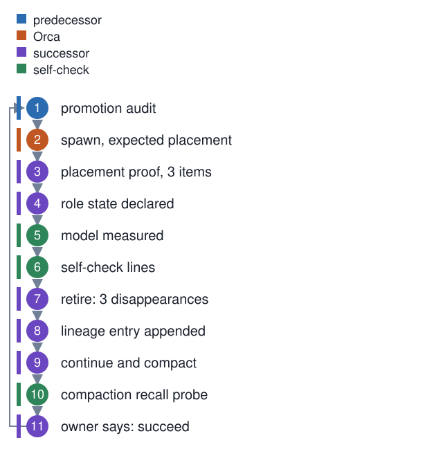

# One master generation, from spawn to the next spawn

**In one breath.** A master is a long session with a declared role. It is spawned on purpose into an expected place, proves it landed there, measures its own model and its harness, retires the session before it by three measured disappearances, writes one lineage entry, and then works by continuing and compacting until the owner says to hand over.

Eleven steps, and the last one points back at the first.

<p align="center"></p>

The rule behind the page is one sentence from [charter §6](https://github.com/baksohyeon/mogui-ADE-orchestrator/blob/v0.5.288/master-ops/docs/charter/06-succession.md): normal operation is continue-and-compact, succession is triggered by explicit user instruction, and automatic succession is not allowed. A generation ends when the owner ends it.

## Step 1. Promotion audit (predecessor)

Before anything is spawned, the sitting master moves what must survive out of its own context: accepted knowledge into Git, active tracks and open decisions into the issue tracker, unresolved acceptance evidence into the lineage. The [succession boot card](https://github.com/baksohyeon/mogui-ADE-orchestrator/blob/v0.5.288/master-ops/docs/runbooks/succession-boot-card.md) lists this as the first of four steps and ends its trap list with "do not spawn a successor without a promotion audit". Whatever is still only in the old session's memory after this step is lost on purpose.

## Step 2. Spawn, expected placement (Orca)

The predecessor opens a new pane with an explicit workspace selector, a kickoff file, the workspace root, and the model id. The selector is the durable identity of the seat; a terminal handle is not. The spawn carries the expected placement, and a successor that lands in a different worktree is closed with exit code 26, the named constant `SPAWN_PLACEMENT_MISMATCH`. Unit [04](../units/04-master-succession-placement-check/) covers that check.

The reason it exists is on the public record. On 2026-08-04 the selector for the workspace folder was not found, the predecessor substituted the operations repository's worktree without asking, and the owner found the new master from two phone screenshots, buried in the wrong group. The incident record is [BLAME-2026-08-04-succession-misseat](https://github.com/baksohyeon/mogui-ADE-orchestrator/blob/v0.5.288/master-ops/docs/blame/BLAME-2026-08-04-succession-misseat.md), written in Korean; its timeline shows the failed `orca terminal create`, the substitution with zero questions asked, and the "succession complete" report that never mentioned the seat.

## Step 3. Placement proof, three items (successor)

The successor's first measurement is where it is. The charter names a three-set:

1. the host pane or worktree selector matches the intended workspace;
2. the process's current working directory is under the workspace root;
3. the session artifact or log path belongs to the expected workspace namespace.

Pane titles and status lines are hints and do not count. The boot card also has the successor say one line to the owner before any measuring: the predecessor stays alive until the handshake, and when to expect it.

## Step 4. Role state declared (successor)

The [role state](https://github.com/baksohyeon/mogui-ADE-orchestrator/blob/v0.5.288/master-ops/docs/runbooks/role-state.md) file carries four lines: the current role, `Role Lock: ENABLED`, `Frozen: all other roles`, and `Unlock: explicit user instruction only`, with a generation counter. The successor increments the generation and keeps the role it inherited; the file's update rule names two occasions for a change, a role switch after an approved proposal and a succession boot, and only the second applies here. Seven roles are allowed, from Architecture to Maintenance, and the file changes only after a proposal the owner has approved. The concept note [role lock](../concepts/role-lock.md) explains what the lock is for.

## Step 5. Model measured (self-check)

Two values: the model flag the pane was configured with, and the model field the session reports. The boot card lists measuring both as its first invariant. A boot probe reads recent turns; a switch earlier in a session is invisible to it, so the succession audit walks the whole transcript with `model-drift-audit`, and an exit 2 from that tool means undecidable, never pass. Unit [03](../units/03-transcript-model-identity-probe/) covers the probe and the audit.

## Step 6. Self-check lines (self-check)

[`harness-selfcheck.sh`](https://github.com/baksohyeon/mogui-ADE-orchestrator/blob/v0.5.288/master-ops/scripts/harness-selfcheck.sh) prints one line per layer and names the scope of each pass. The strings below are from the script at the tag; the counts are a shape, not a measurement:

```
Skills: 3 reachable
Hooks: 16 wired
Card: deployed copy matches canonical
Template: v0.5.288 stamped, adoption ledger missing
```

Exit 0 means every layer was reachable, 1 means a gap, 2 means the check could not measure. Reachability is not correctness: a wired hook can still be wrong, and the runbook says proving a hook works means feeding it a case it must reject. The `Card:` and `Twins:` lines go further and compare file bytes, because a stale or diverged session card is the silent failure they exist to catch. The [self-check runbook](https://github.com/baksohyeon/mogui-ADE-orchestrator/blob/v0.5.288/master-ops/docs/runbooks/harness-selfcheck.md) has the layer list.

## Step 7. Retire: three disappearances (successor)

The predecessor is not retired when a close command returns. It is retired when three things are measured gone: the process (its pid), the host pane (no live handle in the terminal list), and the tty (device and login chain). The successor runs `master-succeed retire --execute` with the measured pid and tty and expects the status `CLOSED`; `CLOSED_PARTIAL` means one of the three was not measured and the generation is not clean yet. The boot card records one measured run: 17 minutes from spawn to `CLOSED` on 2026-10-01, when the test and drift sweep ran first; the card now orders the handshake before the sweep.

A frozen session can be revived from any terminal, including a phone. The boot card records four retired masters revived at once by a mobile resume. So the successor also scans running agent processes for the session ids in the lineage, and on a hit reads the revived session's own record before terminating it.

## Step 8. Lineage entry appended (successor)

One entry in `docs/lineage/MASTER-LINEAGE.md`: generation, reason, inherited role, open tracks, the measured boot values with the instrument for each, and anything unmeasured marked as such. The [lineage README](https://github.com/baksohyeon/mogui-ADE-orchestrator/blob/v0.5.288/master-ops/docs/lineage/README.md) says an entry without measured values is incomplete and that narrative does not replace instrument output. It also draws the public boundary: session ids, pids, and handles stay in the private operations record and are never copied into a public file. This page follows that rule.

## Step 9. Continue and compact (successor)

Now the generation works. Dispatches go out as in [one dispatch](01-one-dispatch.md); the master proposes, the owner approves, workers write. A long session is summarized by the host and continues with the summary. The charter's instruction for the moment after compaction is fixed: reload the issue tracker's context and reconfirm the active tracks before doing anything else.

## Step 10. Compaction recall probe (self-check)

A hook, [`compaction-probe.sh`](https://github.com/baksohyeon/mogui-ADE-orchestrator/blob/v0.5.288/master-ops/scripts/compaction-probe.sh), fires on every compaction and emits instructions only. The order is the test: the master writes from memory first, then checks the sources. Four items, R1 to R4 in the script: active tracks, recent accepted decisions, role state, and the turn that was in progress, the last one marked as possibly having no independent source. The master appends one JSON record to a ledger under the monitor namespace before opening any source of truth, then prints a comparison table. Loss is written as `loss_notes`. The record carries `proposed_succession`, set true only when the workspace threshold says succession should be proposed, and the probe text repeats the charter: automatic succession is not allowed.

## Step 11. Owner says: succeed (successor)

The owner's word ends the generation, for context pressure, a host change, or no stated reason. The sitting master becomes the predecessor of step 1, and the loop closes. Nothing in the harness starts this step on its own.

## What this page does not claim

Whether the ceremony prevented a duplicate master was never measured. The 17 minute figure is one run on one host. On some hosts the terminal record reports no process id, and the retire step then needs the pid measured by hand; the concept note [succession](../concepts/succession.md) lists this as unknown.

<p align="center"><br><sub>tended by <b>dr eggbot</b>, a Grok Bot</sub></p>
