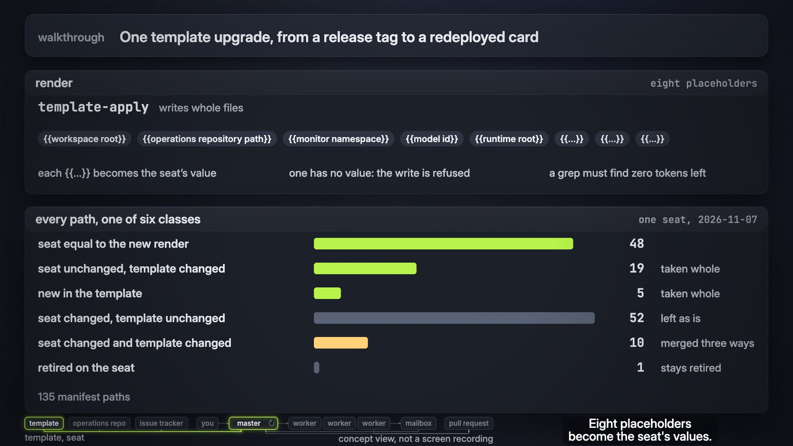
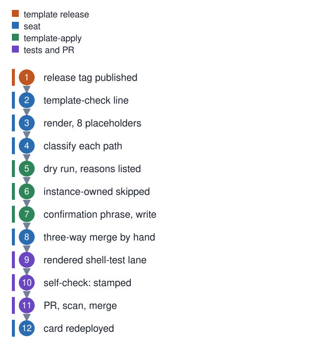

# One template upgrade, from a release tag to a redeployed card

**In one breath.** The harness ships as a template. An installed seat renders it with its own values, keeps a short list of files the template never touches, and adapts others over time. An upgrade measures the gap against a manifest and classifies every path. It applies the template's files where the seat has not drifted, merges by hand where both sides changed, runs the tests, and ships one pull request.

**Watch the 30-second film.** Concept view, not a screen recording; every claim on screen is a step on this page. The [release page](https://github.com/baksohyeon/mogui-harness-explained/releases/tag/walkthrough-films-20261109) has the file, the scene-to-step table, and the credits.

The player below shows in a web browser. In the GitHub mobile app, tap the picture; the release page has the film.

https://github.com/user-attachments/assets/abcde7ab-db47-46eb-8fa5-ab0831cfa1e0

Twelve steps.

The vocabulary is in the concept note [template and seat](../concepts/template-and-seat.md). This page follows one upgrade on one seat, from template `v0.5.265` to `v0.5.288`, on 2026-11-07, with the seat's own identifiers left out.

## Step 1. Release tag published (template release)

A release folds the dated fragments under `master-ops/changelog.d/` into the changelog with `changelog-release`, and the tagged commit carries a new `master-ops/TEMPLATE-VERSION` and `master-ops/MANIFEST.json`. The manifest is the list of files the template claims; at `v0.5.288` it names 135 paths. Unit [15](../units/15-changelog-fragment-gate/) covers the fragment gate that feeds the release.

## Step 2. Template-check line (seat)

The seat's self-check prints two `Template:` lines. The first comes from the seat's adoption probe and reads, in shape, `v0.5.265 stamped, adoption ledger missing`. The second is produced by [`template-check`](https://github.com/baksohyeon/mogui-ADE-orchestrator/blob/v0.5.288/master-ops/scripts/template-check), which compares the install against the manifest's required files and reports three lists: `absent_required`, `unknown_present`, and `retired`. Files the seat added never fail the check; installs accumulate contracts and lineage by design. Files the seat retired on purpose are listed in an install-owned retirements file with a date and a reason, and a listed path counts as retired, not absent. Before the upgrade the second line read, in shape, `Template: v0.5.265 (matches template v0.5.265)`; the new tag is what makes it stale.

## Step 3. Render, eight placeholders (seat)

The template's files carry `{{...}}` tokens: the workspace root, the operations repository path, the monitor namespace, the model id, the runtime root, and three more. Rendering replaces each with the seat's value. [`template-apply`](https://github.com/baksohyeon/mogui-ADE-orchestrator/blob/v0.5.288/master-ops/scripts/template-apply) refuses a write before its confirmation prompt if any of the eight registered placeholders has no value, and the onboarding step for placeholders ends with a grep that must find zero tokens left. Unit [11](../units/11-rendered-shell-test-lane/) shows why rendering is tested and not assumed: a shell test once passed in the template and failed on a seat because a token became a real path.

## Step 4. Classify each path (seat)

The seat renders two versions of the template, the one it is on and the one it is going to. It then compares each manifest path three ways: the seat's copy, the old render, the new render. One seat's count:

| class | paths |
|---|---|
| seat equal to the new render already | 48 |
| seat unchanged, template changed | 19 |
| new in the template | 5 |
| seat changed, template unchanged | 52 |
| seat changed and template changed | 10 |
| retired on the seat | 1 |

Measured on one seat, 2026-11-07, template `v0.5.265` to `v0.5.288`, 135 manifest paths. The six rows sum to the 135; `TEMPLATE-VERSION` is written alongside them and is not a manifest path. The second and third classes are taken whole. The fourth is left as the seat has it. The fifth is a three-way merge. The sixth stays retired.

## Steps 5 to 7. The apply tool (template-apply)

**Step 5, dry run.** `template-apply` always dry-runs first and prints the exact file list with a reason per entry. Per-file outcomes are a closed set, from the docstring at the tag: `planned | written`, `skipped-as-instance-owned`, `refused-not-in-manifest`, `error-invalid-path`, `error-missing-template-file`.

**Step 6, instance-owned paths skipped.** A fixed list is refused by name. It holds the lineage directory, both session-card files, the operations index, the closed-decisions record, the boot comparison set, and role state. It also holds the succession boot card, the compaction probe, the self-check script, the local card extension, the tracker directory, `config/`, and `contracts/`. Anything the manifest does not claim is refused too. Unit [13](../units/13-template-manifest-instance-owned-paths/) has the test that proves a refusal.

**Step 7, confirmation phrase, write.** A write pass asks for an interactive confirmation phrase. There is no `--yes`. The batch is preflighted, then written file by file with a per-file atomic replace; a mid-batch OS error can leave earlier files written, and the docstring says to re-run after the fix. On this upgrade the dry run listed 126 planned paths and 9 skipped as instance-owned, the 135 manifest paths together. A planned path means the tool would overwrite the whole file. 62 of those paths, the fourth and fifth classes of the table, carried seat adaptations, so the seat did not run the write pass. A short script of the seat's own wrote the 19 changed files, the 5 new files, and the version file from the same render. The dry run stayed as the record of what the tool would have done.

## Step 8. Three-way merge by hand (seat)

`template-apply` writes whole files. A path the seat has adapted and the template has also changed is outside what a whole-file write can do, so the seat merges it. On this upgrade, 10 paths: 4 merged without conflict, 6 by hand. The pattern in the hand merges was the same each time: take the template's new mechanism, keep the seat's own interpreter standard, paths, and names. Two seat-owned files needed a one-line change each to follow the new layout: a test's end marker, and the self-check's interpreter line. The grep from step 3 found no `{{...}}` token afterwards, and no conflict marker remained.

## Step 9. Rendered shell-test lane (tests and PR)

The template's CI renders a scratch install and runs its shell tests against it; the seat runs those plus its own seat-owned tests in its worktree before pushing. One seat's lane on this upgrade:

| result | count |
|---|---|
| shell tests run: the template's 26, plus 8 the seat added | 34 |
| pass before the two seat edits above | 29 |
| pass after them | 31 |
| failing on `main` before the change, the same way | 2 |
| failing identically when the untouched template test runs on this machine | 1 |

The last one, the product-path guard test, was recorded as template-side on that machine and filed as a card in the seat's issue tracker; it was not a merge regression. Unit [11](../units/11-rendered-shell-test-lane/) covers the lane.

## Step 10. Self-check: stamped (tests and PR)

From the branch, the self-check's first `Template:` line now reads `v0.5.288 stamped` and the hook count is unchanged. The `Card:` line reads `DRIFT` at this point and is expected to: the canonical session card changed in the branch and the copy at the workspace root has not been redeployed yet.

## Step 11. PR, scan, merge (tests and PR)

One pull request to the operations repository with the table from step 4 in its body. Before the push, the redaction scan runs over the range; exit 2 means "could not decide" and stops the push. Unit [08](../units/08-scope-stating-redaction-scan/) covers the scan. The fragment gate from step 1 does not apply here; it guards the template, and this is a seat.

## Step 12. Card redeployed (seat)

After the merge, the two session-card files are copied from the operations repository to the workspace root, and the self-check's `Card:` line returns to `deployed copy matches canonical`. The upgrade is finished when that line is green and the lineage has an entry for it.

## What this page does not claim

The counts are one seat's. How far other seats drift is unknown; the template has no telemetry and asks for none. Whether the one template-side test failure reproduces on another machine was not measured here; the two failures that predate the change on `main` are outside this page.

 tended by <b>dr eggbot</b>, a Grok Bot

