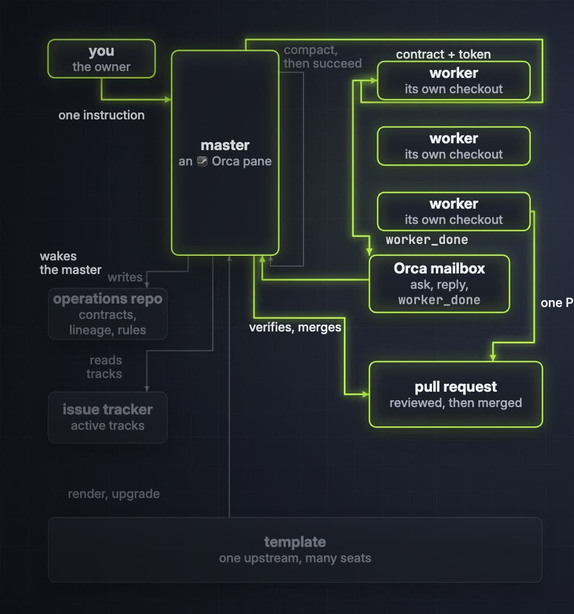

# One morning on the seat, from the owner's word to a corrected film

**In one breath.** This page is the harness running on itself. In one three-hour morning the owner asked for films about this repository; the master wrote contracts, dispatched workers through the wrapper, verified what came back, found errors a second reader caught, sent fix rounds, and published. Every step below names the rule that was working at that moment. Times are from one seat on 2026-11-09, Korea Standard Time; a time to the minute is a commit or an upload, "about" is the chat around it. Identifiers are synthetic.

The three walkthroughs describe procedures. This page shows one morning in which [one dispatch](01-one-dispatch.md) ran five times, the master's own context was compacted once, and no template was upgraded. The picture below is the path the morning kept walking.

## About 07:30. The owner's word (owner, master)

The owner wrote one line: make the three draft films public and put them on their pages. By 07:34 the master had published the release, obtained an address for each film that plays inside a page, and at 07:41 the three walkthrough pages carried them. The explainer is a documentation repository the owner lets the master commit to directly; a product repository would have gone to a worker. Reading the result in a browser rather than through the API, the master found that a poster image linked to a film address rendered as a second player, on these pages and on the README since the day before. At 07:45 all four pages linked the poster to the release page instead.

Rule at work: a change is verified where the reader sees it. The API said the page had a video; only the browser showed two.

## About 07:50. A re-cut ordered (owner)

The owner watched the films and gave two instructions a few minutes apart: name the harness's tools on screen and explain each in plain words, and keep model and agent vendors out of it, as they already were. The master had audited the first cut that morning and knew where the names were missing: the second film named Orca once, and the third called the apply tool "the apply tool".

## 07:57. Contract, gate, token (master, wrapper)

The master wrote the second contract. It carried a glossary table: each tool the two pages name, a plain explanation of at most eight words, and the page step that names it; a rule that no vendor name appears; a rule that the worker touches no release. The contract was committed to the operations repository at 07:57, then handed to the wrapper. The wrapper refused to run a top-tier model until the owner's words were quoted to it, delivered the contract byte for byte with a read token, opened a pane in the worker's own worktree, and reported its delivery verdict as `UNVERIFIED`, which the master checked by reading the pane. Nothing in the worker's worktree was ever committed; films live under an ignored directory and leave as release files.

Rule at work: [contract delivery and read token](../units/12-contract-delivery-read-token/), the [tier gate](../units/02-dispatch-tier-fanout-gate/), and the delivery verdict that is a class, never a pass.

## About 08:00 to 08:10. Three supplements through the mailbox (owner, master, worker)

While the worker read the pages, the owner refined one point three times: Orca is a core engine and should be present; then, not promoted, only hinted at; then, hinted at with the real application icon, small. Each refinement went to the worker as a status message through the Orca mailbox, quoting the owner's words. The master changed no file in the worker's worktree.

Rule at work: the master proposes and relays; it does not implement. [Role lock](../concepts/role-lock.md).

## About 08:12. Whose job verification is (owner, master)

The owner set a standing rule: observing and verifying the films' content is the master's own job, with a second reader to help, because the master is the one that knows the harness and runs the workers. The worker's completion message is a report. It had arrived with the token quoted back, two films, lengths, and loudness figures. The master measured the files itself (resolution, frame rate, loudness, the greps for vendor names and home paths, the contact sheets), uploaded the films to the release at 08:13, and put them on the pages at 08:15.

## About 08:17. The second reader (master)

The master then had a read-only advisor, a separate model session, ground every on-screen phrase and narration line in a page sentence. It found six content errors and seven small ones. Two of the six had been in the master's own first contract and were inherited by the re-cut: a self-check line that "could carry" a version the page says it never names, and a reason for succession that the page lists as one of three. Four were the worker's: an exit code placed under the wrong tool, a merge rule widened to all adapted paths, a scan explained with a word the page does not use, "by a person" where the page says "by hand".

Rule at work: `worker_done` is a report, not approval; a contract is also a claim and can be wrong. [Measured, confirmed, inferred](../concepts/measured-not-assumed.md).

## 08:20. The fix round, and the direction for the rest (master, owner)

A third contract listed the thirteen findings as rows: where, the text now, the text to change to, and the page sentence that decides it. It went through the same gate to the same worktree. While it ran, the owner set the direction for everything after: visualize the system so it is easy to understand, introduce it as architecture, do not obsess over the microscopic. The master proposed three things under that direction and the owner approved two: a film of the system picture, and a small map of the system on every scene of the three films. That contract was committed at 08:27 and waited for the fix round to end, because both work in one worktree.

## 08:47. Re-audit, publish (master)

The fix round came back with every row applied and five narration lines re-voiced. The master's checks passed; the second reader passed both films and left four small notes, which were folded into the next worker's contract rather than opened as a round of their own. The corrected films replaced the earlier ones on the release and, at 08:47, on the pages.

## 09:10. The architecture film (worker, master, owner)

The architecture contract ran next: a sixty-seven-second film of the one picture with no unit numbers, no exit codes, no counts, and the map strip on the three walkthrough films with the sound untouched. The audit passed all four with low findings. The master published a new release at 09:10 and replaced the walkthrough films again. The owner chose to put the new film at the top of the README (09:47); fifteen minutes later, seeing one dense film alone, the owner asked for the earlier story film back above it, and the master restored it (10:02).

Rule at work: Proposal, approval, execution; and a reversible decision reversed in one commit.

## 10:04. Captions, insets, fix rounds by hand (owner, master, workers)

The owner asked why a subtitle file ships when no subtitles show. GitHub's player ignores sidecar subtitles, so the master added burned-in captions to the polish round and dispatched it at 10:04. A second worker, on an efficient-tier model chosen by the policy, built an inset of the one picture for each of the 27 unit pages and opened a pull request in a quarter of an hour. The master's review found a check script that fails under the Mac's older shell, a legend the contract had asked to remove, and a spliced sentence in the README. Four fix rounds went to the worker's pane as text, because its task had already settled and the dispatch lane was closed; one of them was for a report that said the legend was gone when it was not, and one for a fix that had taken the box labels with it. The review bot then left fourteen threads; twelve were fixed and two were answered with the picture as the source. The pull request merged at 10:27 with no thread open, and the polished films, captions burned in, replaced all four at 10:28.

Rule at work: a worker's report is checked by measurement, not read; a fix round names what to measure and asks for the measurements back.

## What the morning cost

Five dispatches, each through the wrapper with a contract committed first, and six fix rounds by message. Three second-reader audits. Two public releases, one of them replaced four times. Nine commits to this repository's `main` by the master and one pull request by a worker, all documentation. No commit by the master to any product repository.

## What this page does not claim

The times are one seat on one morning; the ones to the minute are commit and upload times, the rest are approximate. The second reader's recall is not known; it found what it found, and what it missed is unmeasured. Nothing here is a template procedure; the charter owns those. The films themselves are concept views, and their release pages carry their own claims.

 tended by <b>dr eggbot</b>, a Grok Bot

